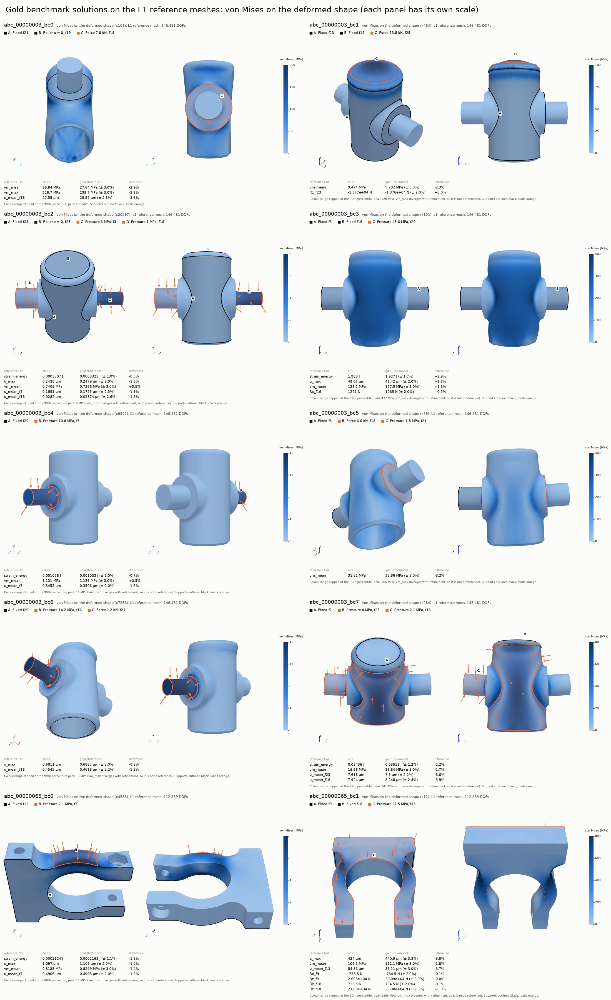

# Gold benchmarks

Real third-party CAD with generated supports and loads, and reference values certified by a
nested-mesh convergence study on the fixed solver. The parts come from the ABC dataset, rescaled
to a 100 mm bounding-box diagonal. The gold-benchmark generator (`feacore.goldgen`, branch
`gold-benchmarks`) produced them on an H100, and `scripts/gold.py import` brought them in from its
archives.

| | |
|---|---|
| Sets | 10 BC sets on 2 parts, from archive `goldgen-l2_0000` |
| Physics | static 3D linear elasticity, steel (E = 210 GPa, nu = 0.3), no gravity |
| Supports, loads | clamped faces and rollers; total forces (1-50 kN) or pressures (1-50 MPa) on faces |
| Study | nested tet10 meshes L0, L1, L2 (h, h/2, h/4; up to 1.0M DOFs), solved with skfem P2 |
| References | QoIs that converged with a fine-grid GCI within 1 % (energy), 2 % (displacement, reaction) or 3 % (stress). Each reference's tolerance is max(that limit, 2 x GCI) |
| Singular QoIs | QoIs that diverge under refinement (peak stress at clamp edges): `expectations()` says "diverge", and they have no reference |

The QoIs are strain energy, max displacement, volume-mean von Mises stress, the mean displacement
of each loaded face and, with several supports, the support reactions. Each set's statement names
the ones it asks for.



The image shows every set re-solved on its L1 mesh. Each panel has von Mises stress on the
deformed shape from two views, with supports outlined black, loads orange, and its own colour
scale. Below each panel, a table compares the L1 values with the gold references.
`scripts/gold.py render --level 1 --png DIR` regenerates it.

## Layout

```
benchmarks/gold/
  index.json                 every set (part, source archive, reference and singular QoIs, DOFs)
                             and every mesh (h, cells, sha256)
  <id>/public/problem.json   statement for agents: supports and loads in words, faces named f<tag>
  <id>/public/geometry.step  the part in metres; its OCC face tags are the f<tag> names
  <id>/private/reference.json   references, the BC set, the reference case, the part's faces
  <id>/private/study.json       QoIs on every mesh level, GCI per QoI
  _meshes/<part>/L<k>.msh    the study's meshes (not in git: 82 MB here; index.json has their sha256)
```

All of a part's BC sets share one STEP file and one mesh sequence. Agents get `public/` only.
Never mount `private/` or `_meshes/` into an agent sandbox.

## How the swarm uses them

- Each set is a registered feacore problem (`feacore.problems.gold.GoldProblem`, tag `gold`,
  family = part id), so `registry.get("abc_00000003_bc0")`, the UI's Benchmarks page and the ACE
  loop's `get_problem` all find it. Nothing needs exporting: the files are the problem.
- `build_geometry()` imports the STEP as is and names every face `f<tag>` and the volume `solid`.
  Those are the groups an agent's mesh must carry, and the groups `inspect_geometry` lists.
- Scoring: every reference in `private/reference.json` with its tolerance.
  `scripts/compare_nafems.py REPLY --problem <id> --root benchmarks/gold` already works for a
  single reply. For a loop that scores one QoI, `GoldProblem.scored_qoi()` picks one: strain
  energy, else a loaded face's mean displacement, else `u_max`, `vm_mean`, then a reaction.
  For ACE: `TASKS[p.id] = {"qoi": p.scored_qoi(), "node_cap": ...}`.
- Uniform refinement is a weak baseline here, because re-entrant edges slow convergence:

  | mesh | DOFs | references within tolerance | median error | worst error |
  |---|---|---|---|---|
  | L0 | 17-23k | 6 of 35 | 5.6 % | 69 % (a reaction) |
  | L1 | 113-146k | 25 of 35 | 1.6 % | 3.9 % |
  | L2 | 0.8-1.0M | 35 of 35 | 0.5 % | 1.3 % |

  An agent working under a node cap of L0-L1 size has to refine locally, where it matters.

| set | supports and loads | references | singular | `scored_qoi()` |
|---|---|---|---|---|
| `abc_00000003_bc0` | clamp f21, roller x f19, force 7.8 kN f18 | vm_mean, vm_max, u_mean_f18 | - | u_mean_f18 |
| `abc_00000003_bc1` | clamp f23, clamp f19, force 13.8 kN f25 | vm_mean, Rz_f23 | vm_max | vm_mean |
| `abc_00000003_bc2` | clamp f23, roller z f25, pressure 6 MPa f3, pressure 1 MPa f16 | strain_energy, u_max, vm_mean, u_mean_f3, u_mean_f16 | vm_max, Rx_f23, Ry_f23 | strain_energy |
| `abc_00000003_bc3` | clamp f3, clamp f16, pressure 45.6 MPa f20 | strain_energy, u_max, vm_mean, Rx_f16 | vm_max, u_mean_f20, Rx_f3, Ry_f3, Ry_f16, Rz_f16 | strain_energy |
| `abc_00000003_bc4` | clamp f20, pressure 10.8 MPa f3 | strain_energy, vm_mean, u_mean_f3 | u_max, vm_max | strain_energy |
| `abc_00000003_bc5` | clamp f3, force 6.6 kN f18, pressure 1.5 MPa f21 | vm_mean | vm_max | vm_mean |
| `abc_00000003_bc6` | clamp f20, pressure 14.2 MPa f16, force 1.2 kN f21 | u_max, u_mean_f16 | vm_mean, vm_max | u_mean_f16 |
| `abc_00000003_bc7` | clamp f2, pressure 4 MPa f23, pressure 2.1 MPa f16 | strain_energy, vm_mean, u_mean_f23, u_mean_f16 | - | strain_energy |
| `abc_00000065_bc0` | clamp f12, pressure 2.1 MPa f7 | strain_energy, u_max, vm_mean, u_mean_f7 | vm_max | strain_energy |
| `abc_00000065_bc1` | clamp f9, clamp f18, pressure 21.5 MPa f13 | u_max, vm_mean, u_mean_f13, Rx_f9, Rz_f9, Rx_f18, Rz_f18 | vm_max | u_mean_f13 |

## Commands

```bash
python scripts/gold.py import goldgen-l2_0001.tgz [more archives or extracted dirs]   # checks, then adds
python scripts/gold.py list [ID | PART ...]                       # references (evaluator-only)
python scripts/gold.py verify [ID ...] --level 0                  # re-solve: the study reproduces
python scripts/gold.py render [ID ...] --level 1 --png out/gold   # runs for the UI viewer, PNGs
```

`import` checks each set before adding it. It needs all four files, consistent ids and nothing
private in `public/`. The reference case must load, every reference must be a stated QoI, and
every group must be a face of the part. The STEP must re-import with the part's face tags. Sets
without a reference are skipped, since there is nothing to score. Importing the same archive
again changes nothing, and new archives from the generator's batcher (`goldgen-l2_0001`, ...) add
to the index. The generator writes a separate STEP copy for each BC set, differing only in a
timestamp. These are stored byte-identical, so git keeps one blob per part.

`verify` and `render` need the meshes, which come with the archive. On a laptop CPU (SciPy
SuperLU), L0 solves in about 1 s and L1 in about 20 s at 3 GB. L2 (1.0M DOFs) needs a GPU (cuDSS)
or tens of GB.

`render` records each solve in the run store (source `gold`, agent `gold:L<level>`), where the
UI's field viewer shows it. `--png DIR` also writes one image per set: von Mises stress on the
deformed shape from two views, with the supports and loads marked. It also writes a contact sheet.

## Checked

- All 10 sets re-solve on L0 with this checkout's solver to the generator's values, to 1e-12
  relative (`verify --level 0`, and `tests/test_gold.py` when the meshes are present).
  Spot-checked on L1 too.
- Every STEP re-imports with the part's 25 / 55 faces at the recorded areas and centroids, to
  1e-11.
- The fixed solver needs the curved-mesh fixes from `gold-benchmarks` (robust inverse
  isoparametric map, Jacobian-based validity for curved cells, reduced SVD in the rigid-body
  checks). Without them, skfem rejects some of these tet10 meshes ("Newton iteration didn't
  converge").
