# Code verification of the solver backends (MMS)

Generated by `scripts/run_code_verification.py` on 2026-10-31 (Python 3.13.18, sympy 1.14.0, scikit-fem 12.0.2, gmsh 4.15.2); backends: skfem, ccx. Raw numbers: [`results.json`](img/code_verification/results.json). Tests: `pytest tests/test_code_verification.py` (add `FEACORE_SLOW=1` for 3D and the CalculiX studies).

## Method

* **Manufactured solutions** (`feacore/verification/mms.py`): smooth, non-polynomial exact fields
  (exp / sin / cos products without symmetries, so neither P1 nor P2 is exact and no error component
  vanishes by accident). sympy derives, in exact rational arithmetic, the body force (`-div sigma`,
  with the axisymmetric `(s_rr - s_tt)/r`, `s_rz/r` terms) or heat source (`-k lap T`), Dirichlet data,
  tractions `sigma.n`, pressures `-n.sigma.n`, fluxes `k dT/dn`, the thermal-strain load, exact
  stresses / fluxes and the exact strain energy `0.5 a(u, u)` (Gauss-Legendre on the exact domain).
  Expressions are printed in the `feacore.case.eval_expr` grammar and checked against `lambdify`.
* **Special BCs are satisfied exactly by construction**: the field is corrected by `phi * c` with
  `phi = 0, dphi/dn = 1` on the boundary (and `phi = dphi/dn = 0` on parallel special boundaries), which
  removes the tangential traction (pressure / symmetry / roller), the normal displacement (symmetry), or
  the Robin residual of a constant `T_inf` (convection), without changing the trace.
* **Independent self-check** (`mms.self_check`, `test_mms_self_check`): the case data *as the solver
  sees it* (strings evaluated by `eval_expr`) is checked against the exact fields with central finite
  differences and an independent numpy constitutive law (plane stress via the 3D law with s_zz = 0).
  All 44 problems: residuals <= 3e-7 (finite-difference accuracy).
* **Domains** (gmsh, named groups): unit square; quarter annulus 0.5 < r < 1 (curved arcs: tests the
  isoparametric P2 geometry and normals of curved facets); unit cube; quarter annular cylinder (3D
  curved faces); axisymmetric ring (r in [0.5, 1.5]) and solid (r in [0, 1], touching the axis; the
  exact fields are regular there: u_r odd, u_z and T even in r).
* **Refinement**: unstructured base mesh (h0 = 0.25 in 2D, 0.5 in 3D) uniformly refined by gmsh
  (new boundary nodes on the CAD curves / surfaces): nested, ratio exactly 2; 2D 4 levels, 3D P1 4 /
  P2 3 levels; P2 meshes are tri6 / tet10 (curved boundaries). Independently remeshed unstructured
  sequences were tried first: their pairwise orders scatter by +-0.4 (e.g. 3.02, 2.88, 3.22 for a P2
  temperature), which makes a finest-pair criterion meaningless, so the nested family is the default.
* **Error measures**: relative RMS error over 2000 (2D) / 2500 (3D) fixed scrambled-Halton points
  covering the exact domain (same points for every mesh; points just outside a discrete curved
  boundary are evaluated in the nearest cell by `Result.probe`): displacement (ux, uy[, uz]) or T;
  recovered stress (sxx, syy, sxy[, szz plane strain][, stt axisymmetric][, syz, sxz]) or flux.
  Energy: `Result.evaluate(strain_energy)` vs the exact `0.5 a(u, u)`.
* **Energy order with corners**: where a Dirichlet face meets a traction / pressure face at 90 degrees
  the *dual* problem has an r^lambda corner singularity (Williams: lambda = 0.711 plane strain /
  axisymmetric / 3D edges, 0.758 plane stress at nu = 0.3), which caps the energy order at
  k + 1 + lambda = 3.71 for P2 even though the exact solution is smooth. Observed: an axisymmetric case
  stalls at 3.67-3.70 over five levels, and the *same* field and BC layout in plane strain stalls at
  3.71, while all-Dirichlet on the same domain gives 4.00: a property of the problem, not the solver.
* **Patch tests**: linear displacement / temperature fields (constant data only, or expression
  Dirichlet data for the general variant; uniform temperature for thermal strain), all BC types incl.
  `force`, `symmetry`, `convection`.
* **Skips**: a backend raising `NotImplementedError` (or not importable) is skipped, not failed.

## Order of accuracy

Observed order = log(e_i / e_i+1) / log(h_i / h_i+1) on the finest pair of a nested study whose errors are above the backend's round-off floor (skfem 1e-10, ccx 3e-6: the `.frd` has ~6 digits). Theory: u = k+1, stress = k, energy = 2k (or k+1+lambda with a Dirichlet-traction corner, see above). Pass: observed >= theory - 0.3 for every measure.

| problem | formulation | domain | P | backend | u order (th.) | stress order (th.) | energy order (th.) | finest e_u | verdict |
|---|---|---|---|---|---|---|---|---|---|
| E-ps-square-dirichlet | plane_stress | square | 1 | skfem | 2.03 (2) | 1.52 (1) | 2.00 (2.00) | 1.3e-04 | pass |
| E-ps-square-dirichlet | plane_stress | square | 2 | skfem | 2.97 (3) | 1.98 (2) | 3.95 (4.00) | 4.5e-07 | pass |
| E-ps-square-dirichlet | plane_stress | square | 1 | ccx | 0.18 (2) | 0.26 (1) | 0.41 (2.00) | 2.1e-03 | **FAIL** |
| E-ps-square-dirichlet | plane_stress | square | 2 | ccx | -0.00 (3) | 0.00 (2) | -0.00 (4.00) | 2.1e-03 | **FAIL** |
| E-ps-square-mixed | plane_stress | square | 1 | skfem | 2.01 (2) | 1.55 (1) | 2.00 (2.00) | 1.6e-04 | pass |
| E-ps-square-mixed | plane_stress | square | 2 | skfem | 2.97 (3) | 1.97 (2) | 3.91 (3.76) | 4.5e-07 | pass |
| E-ps-square-mixed | plane_stress | square | 1 | ccx | 0.14 (2) | 0.99 (1) | 0.20 (2.00) | 3.9e-03 | **FAIL** |
| E-ps-square-mixed | plane_stress | square | 2 | ccx | 0.00 (3) | 0.01 (2) | -0.00 (3.76) | 3.7e-03 | **FAIL** |
| E-pe-square-mixed | plane_strain | square | 1 | skfem | 2.00 (2) | 1.55 (1) | 2.00 (2.00) | 1.6e-04 | pass |
| E-pe-square-mixed | plane_strain | square | 2 | skfem | 2.98 (3) | 1.96 (2) | 3.91 (3.71) | 4.5e-07 | pass |
| E-pe-square-mixed | plane_strain | square | 1 | ccx | 2.00 (2) | 1.54 (1) | 2.00 (2.00) | 1.6e-04 | pass |
| E-pe-square-mixed | plane_strain | square | 2 | ccx | 2.90 (3) | 1.98 (2) | 3.95 (3.71) | 1.4e-06 | pass |
| E-pe-annulus-mixed | plane_strain | annulus | 1 | skfem | 1.91 (2) | 1.53 (1) | 1.98 (2.00) | 6.1e-04 | pass |
| E-pe-annulus-mixed | plane_strain | annulus | 2 | skfem | 3.03 (3) | 1.96 (2) | 4.08 (3.71) | 5.1e-06 | pass |
| E-pe-annulus-mixed | plane_strain | annulus | 1 | ccx | 1.91 (2) | 1.54 (1) | 1.98 (2.00) | 6.1e-04 | pass |
| E-pe-annulus-mixed | plane_strain | annulus | 2 | ccx | 3.02 (3) | 2.01 (2) | 2.58 (3.71) | 5.1e-06 | **FAIL** |
| E-ps-annulus-lame | plane_stress | annulus | 1 | skfem | 1.98 (2) | 1.53 (1) | 1.99 (2.00) | 1.4e-03 | pass |
| E-ps-annulus-lame | plane_stress | annulus | 2 | skfem | 3.04 (3) | 1.90 (2) | 3.92 (4.00) | 2.7e-06 | pass |
| E-ps-annulus-lame | plane_stress | annulus | 1 | ccx | 1.98 (2) | 1.55 (1) | 1.98 (2.00) | 1.6e-03 | pass |
| E-ps-annulus-lame | plane_stress | annulus | 2 | ccx | 3.05 (3) | 1.93 (2) | 3.74 (4.00) | 2.8e-06 | pass |
| E-pe-annulus-lame | plane_strain | annulus | 1 | skfem | 1.98 (2) | 1.50 (1) | 1.98 (2.00) | 1.7e-03 | pass |
| E-pe-annulus-lame | plane_strain | annulus | 2 | skfem | 3.06 (3) | 1.88 (2) | 3.91 (4.00) | 2.9e-06 | pass |
| E-pe-annulus-lame | plane_strain | annulus | 1 | ccx | 1.98 (2) | 1.54 (1) | 1.98 (2.00) | 1.7e-03 | pass |
| E-pe-annulus-lame | plane_strain | annulus | 2 | ccx | 3.05 (3) | 1.93 (2) | 3.87 (4.00) | 3.0e-06 | pass |
| E-pe-square-thermal | plane_strain | square | 1 | skfem | 2.00 (2) | 1.54 (1) | info 2.00 | 1.6e-04 | pass |
| E-pe-square-thermal | plane_strain | square | 2 | skfem | 2.98 (3) | 1.96 (2) | info 3.91 | 4.5e-07 | pass |
| E-pe-square-thermal | plane_strain | square | 1 | ccx | 2.00 (2) | 1.54 (1) | info 1.99 | 1.7e-04 | pass |
| E-pe-square-thermal | plane_strain | square | 2 | ccx | 2.90 (3) | 1.96 (2) | info -0.12 | 1.4e-06 | pass |
| E-ax-ring-mixed | axisymmetric | axi_ring | 1 | skfem | 1.99 (2) | 1.49 (1) | 2.00 (2.00) | 1.9e-04 | pass |
| E-ax-ring-mixed | axisymmetric | axi_ring | 2 | skfem | 2.99 (3) | 1.96 (2) | 4.07 (3.71) | 6.7e-07 | pass |
| E-ax-ring-mixed | axisymmetric | axi_ring | 1 | ccx | 2.29 (2) | 1.51 (1) | 2.99 (2.00) | 1.4e-04 | pass |
| E-ax-ring-mixed | axisymmetric | axi_ring | 2 | ccx | 2.95 (3) | 1.46 (2) | 4.77 (3.71) | 1.8e-06 | **FAIL** |
| E-ax-solid-mixed | axisymmetric | axi_solid | 1 | skfem | 1.93 (2) | 1.54 (1) | 1.98 (2.00) | 2.6e-04 | pass |
| E-ax-solid-mixed | axisymmetric | axi_solid | 2 | skfem | 3.02 (3) | 1.97 (2) | 3.62 (3.71) | 8.7e-07 | pass |
| E-ax-solid-mixed | axisymmetric | axi_solid | 1 | ccx | 1.89 (2) | 1.54 (1) | 1.75 (2.00) | 2.6e-04 | pass |
| E-ax-solid-mixed | axisymmetric | axi_solid | 2 | ccx | 2.99 (3) | 1.91 (2) | 1.46 (3.71) | 1.2e-06 | **FAIL** |
| E-ax-ring-lame | axisymmetric | axi_ring | 1 | skfem | 1.97 (2) | 1.47 (1) | 1.99 (2.00) | 2.1e-04 | pass |
| E-ax-ring-lame | axisymmetric | axi_ring | 2 | skfem | 3.05 (3) | 1.96 (2) | 3.96 (4.00) | 1.8e-06 | pass |
| E-ax-ring-lame | axisymmetric | axi_ring | 1 | ccx | 1.62 (2) | 1.40 (1) | 6.75 (2.00) | 2.4e-04 | **FAIL** |
| E-ax-ring-lame | axisymmetric | axi_ring | 2 | ccx | 2.93 (3) | 1.69 (2) | 4.03 (4.00) | 1.9e-06 | **FAIL** |
| E-3d-cube-mixed | 3d | cube | 1 | skfem | 1.77 (2) | 1.48 (1) | 1.95 (2.00) | 6.5e-04 | pass |
| E-3d-cube-mixed | 3d | cube | 2 | skfem | 2.99 (3) | 1.91 (2) | 5.24 (3.71) | 1.3e-05 | pass |
| E-3d-cube-mixed | 3d | cube | 1 | ccx | 1.77 (2) | 1.41 (1) | 1.95 (2.00) | 6.5e-04 | pass |
| E-3d-cube-mixed | 3d | cube | 2 | ccx | 2.99 (3) | 1.92 (2) | 4.24 (3.71) | 1.3e-05 | pass |
| E-3d-annulus3d-lame | 3d | annulus3d | 1 | skfem | 1.69 (2) | 1.14 (1) | 1.76 (2.00) | 7.3e-03 | **FAIL** |
| E-3d-annulus3d-lame | 3d | annulus3d | 2 | skfem | 2.96 (3) | 1.66 (2) | 3.41 (4.00) | 5.8e-05 | **FAIL** |
| E-3d-annulus3d-lame | 3d | annulus3d | 1 | ccx | 1.69 (2) | 1.12 (1) | 1.76 (2.00) | 7.3e-03 | **FAIL** |
| E-3d-annulus3d-lame | 3d | annulus3d | 2 | ccx | 2.96 (3) | 1.77 (2) | 3.39 (4.00) | 5.9e-05 | **FAIL** |
| H-2d-square-mixed | 2d | square | 1 | skfem | 2.04 (2) | 1.48 (1) | n/a | 9.8e-05 | pass |
| H-2d-square-mixed | 2d | square | 2 | skfem | 2.98 (3) | 1.99 (2) | n/a | 2.9e-07 | pass |
| H-2d-square-mixed | 2d | square | 1 | ccx | 2.05 (2) | 1.51 (1) | n/a | 9.5e-05 | pass |
| H-2d-square-mixed | 2d | square | 2 | ccx | 2.98 (3) | 1.98 (2) | n/a | 6.7e-07 | pass |
| H-2d-annulus-mixed | 2d | annulus | 1 | skfem | 2.00 (2) | 1.53 (1) | n/a | 1.0e-04 | pass |
| H-2d-annulus-mixed | 2d | annulus | 2 | skfem | 2.98 (3) | 1.96 (2) | n/a | 5.6e-07 | pass |
| H-2d-annulus-mixed | 2d | annulus | 1 | ccx | 2.00 (2) | 1.51 (1) | n/a | 9.9e-05 | pass |
| H-2d-annulus-mixed | 2d | annulus | 2 | ccx | 2.99 (3) | 1.98 (2) | n/a | 1.1e-06 | pass |
| H-2d-annulus-log | 2d | annulus | 1 | skfem | 2.00 (2) | 1.51 (1) | n/a | 7.9e-05 | pass |
| H-2d-annulus-log | 2d | annulus | 2 | skfem | 3.00 (3) | 1.91 (2) | n/a | 6.3e-07 | pass |
| H-2d-annulus-log | 2d | annulus | 1 | ccx | 2.00 (2) | 1.52 (1) | n/a | 7.9e-05 | pass |
| H-2d-annulus-log | 2d | annulus | 2 | ccx | 2.93 (3) | 1.95 (2) | n/a | 6.9e-07 | pass |
| H-ax-ring-mixed | axisymmetric | axi_ring | 1 | skfem | 1.99 (2) | 1.52 (1) | n/a | 2.2e-05 | pass |
| H-ax-ring-mixed | axisymmetric | axi_ring | 2 | skfem | 2.99 (3) | 1.95 (2) | n/a | 4.9e-08 | pass |
| H-ax-ring-mixed | axisymmetric | axi_ring | 1 | ccx | 2.11 (2) | 1.53 (1) | n/a | 1.9e-05 | pass |
| H-ax-ring-mixed | axisymmetric | axi_ring | 2 | ccx | 2.94 (3) | 1.86 (2) | n/a | 8.7e-07 | pass |
| H-ax-solid-mixed | axisymmetric | axi_solid | 1 | skfem | 1.95 (2) | 1.51 (1) | n/a | 5.2e-05 | pass |
| H-ax-solid-mixed | axisymmetric | axi_solid | 2 | skfem | 2.96 (3) | 1.98 (2) | n/a | 1.6e-07 | pass |
| H-ax-solid-mixed | axisymmetric | axi_solid | 1 | ccx | 1.71 (2) | 1.19 (1) | n/a | 9.1e-05 | pass |
| H-ax-solid-mixed | axisymmetric | axi_solid | 2 | ccx | 2.99 (3) | 1.84 (2) | n/a | 1.3e-06 | pass |
| H-3d-cube-mixed | 3d | cube | 1 | skfem | 1.91 (2) | 1.47 (1) | n/a | 4.3e-04 | pass |
| H-3d-cube-mixed | 3d | cube | 2 | skfem | 2.96 (3) | 1.89 (2) | n/a | 1.2e-05 | pass |
| H-3d-cube-mixed | 3d | cube | 1 | ccx | 1.91 (2) | 1.41 (1) | n/a | 4.2e-04 | pass |
| H-3d-cube-mixed | 3d | cube | 2 | ccx | 2.95 (3) | 1.91 (2) | n/a | 1.2e-05 | pass |

All pairwise orders (coarse to fine)

| problem | P | backend | u | stress | energy |
|---|---|---|---|---|---|
| E-ps-square-dirichlet | 1 | skfem | 2.00, 1.98, 2.03 | 1.54, 1.49, 1.52 | 2.04, 2.01, 2.00 |
| E-ps-square-dirichlet | 2 | skfem | 3.03, 3.02, 2.97 | 1.91, 1.97, 1.98 | 3.97, 3.94, 3.95 |
| E-ps-square-dirichlet | 1 | ccx | 1.38, 0.62, 0.18 | 1.56, 1.32, 0.26 | 1.67, 1.02, 0.41 |
| E-ps-square-dirichlet | 2 | ccx | 0.02, 0.00, -0.00 | 0.17, 0.01, 0.00 | -0.05, -0.01, -0.00 |
| E-ps-square-mixed | 1 | skfem | 1.96, 1.96, 2.01 | 1.61, 1.53, 1.55 | 1.97, 1.99, 2.00 |
| E-ps-square-mixed | 2 | skfem | 2.97, 2.99, 2.97 | 1.88, 1.95, 1.97 | 3.91, 3.91, 3.91 |
| E-ps-square-mixed | 1 | ccx | 1.13, 0.48, 0.14 | 1.51, 1.53, 0.99 | 1.21, 0.59, 0.20 |
| E-ps-square-mixed | 2 | ccx | 0.02, 0.00, 0.00 | 0.52, 0.06, 0.01 | 0.01, -0.00, -0.00 |
| E-pe-square-mixed | 1 | skfem | 1.94, 1.95, 2.00 | 1.62, 1.52, 1.55 | 1.97, 1.99, 2.00 |
| E-pe-square-mixed | 2 | skfem | 2.97, 2.99, 2.98 | 1.87, 1.95, 1.96 | 3.92, 3.91, 3.91 |
| E-pe-square-mixed | 1 | ccx | 1.94, 1.95, 2.00 | 1.48, 1.54, 1.54 | 1.97, 1.99, 2.00 |
| E-pe-square-mixed | 2 | ccx | 2.97, 2.90, 1.49 | 1.93, 1.99, 1.98 | 3.95, 4.32, 0.00 |
| E-pe-annulus-mixed | 1 | skfem | 1.77, 1.84, 1.91 | 1.53, 1.53, 1.53 | 1.93, 1.96, 1.98 |
| E-pe-annulus-mixed | 2 | skfem | 3.01, 3.07, 3.03 | 1.82, 1.81, 1.96 | 3.71, 3.95, 4.08 |
| E-pe-annulus-mixed | 1 | ccx | 1.77, 1.84, 1.91 | 1.39, 1.50, 1.54 | 1.94, 1.96, 1.98 |
| E-pe-annulus-mixed | 2 | ccx | 3.00, 3.07, 3.02 | 1.91, 1.89, 2.01 | 3.71, 4.02, 2.58 |
| E-ps-annulus-lame | 1 | skfem | 1.90, 1.96, 1.98 | 1.55, 1.50, 1.53 | 1.91, 1.97, 1.99 |
| E-ps-annulus-lame | 2 | skfem | 3.00, 3.03, 3.04 | 1.85, 1.84, 1.90 | 3.71, 3.85, 3.92 |
| E-ps-annulus-lame | 1 | ccx | 1.87, 1.94, 1.98 | 1.50, 1.53, 1.55 | 1.88, 1.95, 1.98 |
| E-ps-annulus-lame | 2 | ccx | 3.01, 3.05, 3.04 | 1.87, 1.87, 1.93 | 3.64, 3.74, 4.29 |
| E-pe-annulus-lame | 1 | skfem | 1.88, 1.94, 1.98 | 1.51, 1.46, 1.50 | 1.88, 1.95, 1.98 |
| E-pe-annulus-lame | 2 | skfem | 3.03, 3.06, 3.06 | 1.80, 1.80, 1.88 | 3.68, 3.83, 3.91 |
| E-pe-annulus-lame | 1 | ccx | 1.88, 1.94, 1.98 | 1.50, 1.53, 1.54 | 1.88, 1.95, 1.98 |
| E-pe-annulus-lame | 2 | ccx | 3.01, 3.05, 3.04 | 1.87, 1.86, 1.93 | 3.64, 3.79, 3.87 |
| E-pe-square-thermal | 1 | skfem | 1.94, 1.95, 2.00 | 1.62, 1.52, 1.54 | 1.97, 1.99, 2.00 |
| E-pe-square-thermal | 2 | skfem | 2.97, 2.99, 2.98 | 1.87, 1.95, 1.96 | 3.92, 3.91, 3.91 |
| E-pe-square-thermal | 1 | ccx | 1.95, 1.95, 2.00 | 1.50, 1.56, 1.54 | 1.97, 1.99, 1.99 |
| E-pe-square-thermal | 2 | ccx | 2.97, 2.90, 1.49 | 1.93, 2.00, 1.96 | 4.13, 2.81, -0.12 |
| E-ax-ring-mixed | 1 | skfem | 1.95, 1.98, 1.99 | 1.53, 1.48, 1.49 | 1.98, 1.99, 2.00 |
| E-ax-ring-mixed | 2 | skfem | 3.03, 3.01, 2.99 | 1.93, 1.97, 1.96 | 4.10, 4.07, 4.07 |
| E-ax-ring-mixed | 1 | ccx | 1.99, 2.10, 2.29 | 1.47, 1.50, 1.51 | 2.02, 2.16, 2.99 |
| E-ax-ring-mixed | 2 | ccx | 3.02, 2.95, 1.64 | 1.98, 1.97, 1.46 | 4.77, 2.73, 2.72 |
| E-ax-solid-mixed | 1 | skfem | 1.87, 1.93, 1.93 | 1.65, 1.54, 1.54 | 1.89, 1.95, 1.98 |
| E-ax-solid-mixed | 2 | skfem | 2.96, 2.99, 3.02 | 1.95, 1.98, 1.97 | 3.19, 3.49, 3.62 |
| E-ax-solid-mixed | 1 | ccx | 1.87, 1.92, 1.89 | 1.40, 1.53, 1.54 | 1.85, 1.88, 1.75 |
| E-ax-solid-mixed | 2 | ccx | 3.01, 2.99, 2.73 | 1.97, 1.98, 1.91 | 3.21, 1.69, 1.46 |
| E-ax-ring-lame | 1 | skfem | 1.86, 1.95, 1.97 | 1.33, 1.40, 1.47 | 1.89, 1.97, 1.99 |
| E-ax-ring-lame | 2 | skfem | 2.87, 2.93, 3.05 | 1.83, 1.88, 1.96 | 3.77, 3.91, 3.96 |
| E-ax-ring-lame | 1 | ccx | 1.87, 1.85, 1.62 | 1.13, 1.30, 1.40 | 1.93, 2.26, 6.75 |
| E-ax-ring-lame | 2 | ccx | 2.86, 2.93, 2.99 | 1.88, 1.89, 1.69 | 3.62, 4.03, 4.68 |
| E-3d-cube-mixed | 1 | skfem | 1.52, 1.63, 1.77 | 1.26, 1.36, 1.48 | 1.81, 1.89, 1.95 |
| E-3d-cube-mixed | 2 | skfem | 2.55, 2.99 | 1.77, 1.91 | 4.18, 5.24 |
| E-3d-cube-mixed | 1 | ccx | 1.52, 1.63, 1.77 | 1.32, 1.31, 1.41 | 1.81, 1.89, 1.95 |
| E-3d-cube-mixed | 2 | ccx | 2.55, 2.99 | 1.78, 1.92 | 4.24, 4.65 |
| E-3d-annulus3d-lame | 1 | skfem | 1.64, 1.69 | 1.06, 1.14 | 1.66, 1.76 |
| E-3d-annulus3d-lame | 2 | skfem | 1.75, 2.96 | 1.47, 1.66 | 2.85, 3.41 |
| E-3d-annulus3d-lame | 1 | ccx | 1.64, 1.69 | 1.20, 1.12 | 1.66, 1.76 |
| E-3d-annulus3d-lame | 2 | ccx | 1.74, 2.96 | 1.64, 1.77 | 2.82, 3.39 |
| H-2d-square-mixed | 1 | skfem | 1.96, 1.98, 2.04 | 1.43, 1.48, 1.48 | - |
| H-2d-square-mixed | 2 | skfem | 2.98, 2.99, 2.98 | 1.95, 1.98, 1.99 | - |
| H-2d-square-mixed | 1 | ccx | 1.96, 1.98, 2.05 | 1.47, 1.50, 1.51 | - |
| H-2d-square-mixed | 2 | ccx | 2.98, 2.95, 1.83 | 1.98, 1.99, 1.98 | - |
| H-2d-annulus-mixed | 1 | skfem | 1.91, 1.96, 2.00 | 1.35, 1.50, 1.53 | - |
| H-2d-annulus-mixed | 2 | skfem | 2.96, 3.02, 2.98 | 1.98, 1.95, 1.96 | - |
| H-2d-annulus-mixed | 1 | ccx | 1.91, 1.96, 2.00 | 1.45, 1.46, 1.51 | - |
| H-2d-annulus-mixed | 2 | ccx | 2.95, 2.99, 1.99 | 2.00, 1.96, 1.98 | - |
| H-2d-annulus-log | 1 | skfem | 1.90, 1.96, 2.00 | 1.47, 1.51, 1.51 | - |
| H-2d-annulus-log | 2 | skfem | 2.86, 2.93, 3.00 | 1.85, 1.87, 1.91 | - |
| H-2d-annulus-log | 1 | ccx | 1.90, 1.96, 2.00 | 1.47, 1.51, 1.52 | - |
| H-2d-annulus-log | 2 | ccx | 2.87, 2.93, 2.88 | 1.93, 1.92, 1.95 | - |
| H-ax-ring-mixed | 1 | skfem | 1.99, 1.99, 1.99 | 1.53, 1.52, 1.52 | - |
| H-ax-ring-mixed | 2 | skfem | 2.99, 3.00, 2.99 | 1.97, 1.97, 1.95 | - |
| H-ax-ring-mixed | 1 | ccx | 1.99, 2.02, 2.11 | 1.47, 1.52, 1.53 | - |
| H-ax-ring-mixed | 2 | ccx | 2.94, 1.75, 0.14 | 1.99, 1.98, 1.86 | - |
| H-ax-solid-mixed | 1 | skfem | 1.97, 2.01, 1.95 | 1.60, 1.53, 1.51 | - |
| H-ax-solid-mixed | 2 | skfem | 2.99, 2.98, 2.96 | 1.96, 1.98, 1.98 | - |
| H-ax-solid-mixed | 1 | ccx | 1.85, 1.83, 1.71 | 1.31, 1.34, 1.19 | - |
| H-ax-solid-mixed | 2 | ccx | 2.99, 2.52, 0.54 | 1.98, 1.98, 1.84 | - |
| H-3d-cube-mixed | 1 | skfem | 1.64, 1.82, 1.91 | 1.17, 1.34, 1.47 | - |
| H-3d-cube-mixed | 2 | skfem | 2.49, 2.96 | 1.68, 1.89 | - |
| H-3d-cube-mixed | 1 | ccx | 1.63, 1.82, 1.91 | 1.30, 1.30, 1.41 | - |
| H-3d-cube-mixed | 2 | ccx | 2.49, 2.95 | 1.72, 1.91 | - |

## Patch tests

Linear fields on distorted meshes (interior nodes moved by up to 0.3 h; P2 midside nodes moved off the chord, i.e. curved interior edges). Max relative error of nodal u, probed u and probed recovered stress / flux; tolerance skfem 1e-9 / 1e-8, ccx 5e-5 (output precision).

| patch | formulation | P | backend | err u (nodal) | err u (probe) | err stress | err energy | verdict |
|---|---|---|---|---|---|---|---|---|
| P-ps-const-roller | plane_stress | 1 | skfem | 1.3e-15 | 1.3e-15 | 2.9e-15 | 1.0e-15 | pass |
| P-ps-const-roller | plane_stress | 2 | skfem | 3.5e-15 | 3.3e-15 | 9.4e-15 | 2.5e-15 | pass |
| P-ps-const-roller | plane_stress | 1 | ccx | 2.5e-06 | 2.4e-06 | 1.0e-06 | 4.2e-08 | pass |
| P-ps-const-roller | plane_stress | 2 | ccx | 2.5e-06 | 2.5e-06 | 1.2e-05 | 4.2e-08 | pass |
| P-ps-const-sym | plane_stress | 1 | skfem | 1.2e-15 | 1.2e-15 | 3.3e-15 | 1.2e-15 | pass |
| P-ps-const-sym | plane_stress | 2 | skfem | 4.0e-15 | 4.0e-15 | 1.3e-14 | 8.3e-16 | pass |
| P-ps-const-sym | plane_stress | 1 | ccx | 2.5e-06 | 2.4e-06 | 1.0e-06 | 4.2e-08 | pass |
| P-ps-const-sym | plane_stress | 2 | ccx | 2.5e-06 | 2.5e-06 | 1.2e-05 | 4.2e-08 | pass |
| P-ps-general | plane_stress | 1 | skfem | 3.0e-15 | 3.0e-15 | 1.2e-14 | 7.6e-16 | pass |
| P-ps-general | plane_stress | 2 | skfem | 5.8e-15 | 5.6e-15 | 3.3e-14 | 3.2e-15 | pass |
| P-ps-general | plane_stress | 1 | ccx | 1.1e-06 | 1.0e-06 | 1.0e-06 | 9.6e-08 | pass |
| P-ps-general | plane_stress | 2 | ccx | 1.2e-06 | 1.2e-06 | 1.2e-05 | 9.6e-08 | pass |
| P-ps-thermal | plane_stress | 1 | skfem | 1.7e-15 | 1.7e-15 | 2.9e-15 | - | pass |
| P-ps-thermal | plane_stress | 2 | skfem | 5.9e-15 | 5.9e-15 | 1.4e-14 | - | pass |
| P-ps-thermal | plane_stress | 1 | ccx | 1.0e-06 | 8.9e-07 | 3.3e-15 | - | pass |
| P-ps-thermal | plane_stress | 2 | ccx | 1.0e-06 | 1.0e-06 | 2.4e-14 | - | pass |
| P-pe-const-roller | plane_strain | 1 | skfem | 3.2e-15 | 3.0e-15 | 4.7e-15 | 1.2e-15 | pass |
| P-pe-const-roller | plane_strain | 2 | skfem | 8.5e-15 | 7.4e-15 | 1.6e-14 | 6.3e-15 | pass |
| P-pe-const-roller | plane_strain | 1 | ccx | 2.5e-06 | 2.4e-06 | 2.2e-06 | 2.1e-07 | pass |
| P-pe-const-roller | plane_strain | 2 | ccx | 2.5e-06 | 2.5e-06 | 1.2e-05 | 2.1e-07 | pass |
| P-pe-const-sym | plane_strain | 1 | skfem | 2.1e-15 | 2.0e-15 | 3.6e-15 | 3.9e-16 | pass |
| P-pe-const-sym | plane_strain | 2 | skfem | 5.3e-15 | 5.2e-15 | 1.5e-14 | 6.5e-15 | pass |
| P-pe-const-sym | plane_strain | 1 | ccx | 2.5e-06 | 2.4e-06 | 2.2e-06 | 2.1e-07 | pass |
| P-pe-const-sym | plane_strain | 2 | ccx | 2.5e-06 | 2.5e-06 | 1.2e-05 | 2.1e-07 | pass |
| P-pe-general | plane_strain | 1 | skfem | 1.3e-15 | 1.4e-15 | 7.0e-15 | 9.0e-16 | pass |
| P-pe-general | plane_strain | 2 | skfem | 4.6e-15 | 4.6e-15 | 2.6e-14 | 1.4e-14 | pass |
| P-pe-general | plane_strain | 1 | ccx | 1.1e-06 | 1.0e-06 | 2.2e-06 | 6.4e-08 | pass |
| P-pe-general | plane_strain | 2 | ccx | 1.2e-06 | 1.2e-06 | 1.2e-05 | 6.4e-08 | pass |
| P-pe-thermal | plane_strain | 1 | skfem | 4.1e-15 | 4.0e-15 | 9.0e-15 | - | pass |
| P-pe-thermal | plane_strain | 2 | skfem | 7.1e-15 | 7.0e-15 | 2.8e-14 | - | pass |
| P-pe-thermal | plane_strain | 1 | ccx | 7.7e-07 | 6.9e-07 | 5.6e-15 | - | pass |
| P-pe-thermal | plane_strain | 2 | ccx | 7.8e-07 | 8.4e-07 | 1.0e-05 | - | pass |
| P-3d-const-roller | 3d | 1 | skfem | 1.4e-15 | 1.2e-15 | 1.6e-15 | 1.9e-16 | pass |
| P-3d-const-roller | 3d | 2 | skfem | 6.0e-15 | 4.5e-15 | 8.8e-15 | 3.6e-15 | pass |
| P-3d-const-roller | 3d | 1 | ccx | 2.3e-06 | 1.9e-06 | 1.3e-06 | 3.4e-08 | pass |
| P-3d-const-roller | 3d | 2 | ccx | 6.0e-05 | 2.6e-05 | 1.4e-04 | 3.4e-08 | **FAIL** |
| P-3d-const-sym | 3d | 1 | skfem | 1.5e-15 | 1.5e-15 | 1.6e-15 | 3.8e-16 | pass |
| P-3d-const-sym | 3d | 2 | skfem | 6.5e-15 | 5.9e-15 | 7.9e-15 | 4.9e-15 | pass |
| P-3d-const-sym | 3d | 1 | ccx | 2.3e-06 | 1.9e-06 | 1.3e-06 | 3.4e-08 | pass |
| P-3d-const-sym | 3d | 2 | ccx | 6.0e-05 | 2.6e-05 | 1.4e-04 | 3.4e-08 | **FAIL** |
| P-3d-general | 3d | 1 | skfem | 1.5e-15 | 1.3e-15 | 4.6e-15 | 2.3e-15 | pass |
| P-3d-general | 3d | 2 | skfem | 6.4e-15 | 4.0e-15 | 2.0e-14 | 8.1e-15 | pass |
| P-3d-general | 3d | 1 | ccx | 9.6e-07 | 8.8e-07 | 8.2e-07 | 7.4e-08 | pass |
| P-3d-general | 3d | 2 | ccx | 1.9e-05 | 9.1e-06 | 1.0e-04 | 1.6e-06 | **FAIL** |
| P-3d-thermal | 3d | 1 | skfem | 1.9e-15 | 1.7e-15 | 3.0e-15 | - | pass |
| P-3d-thermal | 3d | 2 | skfem | 7.5e-15 | 4.9e-15 | 1.3e-14 | - | pass |
| P-3d-thermal | 3d | 1 | ccx | 9.6e-07 | 9.2e-07 | 2.1e-15 | - | pass |
| P-3d-thermal | 3d | 2 | ccx | 1.0e-06 | 1.2e-06 | 1.5e-14 | - | pass |
| P-ax-ring-const | axisymmetric | 1 | skfem | 2.7e-15 | 2.7e-15 | 3.4e-15 | 5.2e-16 | pass |
| P-ax-ring-const | axisymmetric | 2 | skfem | 1.4e-14 | 1.4e-14 | 2.1e-14 | 1.2e-15 | pass |
| P-ax-ring-const | axisymmetric | 1 | ccx | 2.0e-04 | 2.0e-04 | 2.0e-04 | 2.0e-04 | **FAIL** |
| P-ax-ring-const | axisymmetric | 2 | ccx | 1.1e-03 | 4.8e-04 | 5.7e-03 | 1.9e-05 | **FAIL** |
| P-ax-ring-general | axisymmetric | 1 | skfem | 3.6e-15 | 3.3e-15 | 4.5e-15 | 2.1e-15 | pass |
| P-ax-ring-general | axisymmetric | 2 | skfem | 9.8e-15 | 9.6e-15 | 1.8e-14 | 3.0e-15 | pass |
| P-ax-ring-general | axisymmetric | 1 | ccx | 1.7e-04 | 1.7e-04 | 2.2e-04 | 1.2e-04 | **FAIL** |
| P-ax-ring-general | axisymmetric | 2 | ccx | 5.6e-04 | 3.9e-04 | 2.4e-03 | 3.6e-05 | **FAIL** |
| P-ax-ring-thermal | axisymmetric | 1 | skfem | 4.4e-15 | 4.4e-15 | 1.3e-14 | - | pass |
| P-ax-ring-thermal | axisymmetric | 2 | skfem | 1.5e-14 | 1.4e-14 | 3.0e-14 | - | pass |
| P-ax-ring-thermal | axisymmetric | 1 | ccx | 6.9e-07 | 5.8e-07 | 1.8e-14 | - | pass |
| P-ax-ring-thermal | axisymmetric | 2 | ccx | 6.9e-07 | 1.1e-04 | 7.3e-14 | - | **FAIL** |
| P-ax-solid-const | axisymmetric | 1 | skfem | 2.8e-15 | 2.8e-15 | 3.4e-15 | 1.4e-15 | pass |
| P-ax-solid-const | axisymmetric | 2 | skfem | 8.1e-15 | 8.7e-15 | 8.9e-15 | 2.3e-15 | pass |
| P-ax-solid-const | axisymmetric | 1 | ccx | 2.0e-04 | 2.0e-04 | 2.0e-04 | 2.0e-04 | **FAIL** |
| P-ax-solid-const | axisymmetric | 2 | ccx | 4.4e-03 | 2.8e-03 | 2.2e-02 | 1.0e-05 | **FAIL** |
| P-ax-solid-general | axisymmetric | 1 | skfem | 6.3e-15 | 6.3e-15 | 7.2e-15 | 3.3e-15 | pass |
| P-ax-solid-general | axisymmetric | 2 | skfem | 1.3e-14 | 1.2e-14 | 1.1e-14 | 1.9e-15 | pass |
| P-ax-solid-general | axisymmetric | 1 | ccx | 1.8e-04 | 1.8e-04 | 2.2e-04 | 1.6e-04 | **FAIL** |
| P-ax-solid-general | axisymmetric | 2 | ccx | 3.5e-03 | 2.2e-03 | 2.2e-02 | 7.6e-06 | **FAIL** |
| P-ax-solid-thermal | axisymmetric | 1 | skfem | 2.8e-15 | 2.8e-15 | 4.4e-15 | - | pass |
| P-ax-solid-thermal | axisymmetric | 2 | skfem | 8.3e-15 | 8.5e-15 | 1.6e-14 | - | pass |
| P-ax-solid-thermal | axisymmetric | 1 | ccx | 1.0e-06 | 8.9e-07 | 2.8e-13 | - | pass |
| P-ax-solid-thermal | axisymmetric | 2 | ccx | 1.0e-06 | 1.1e-06 | 2.1e-11 | - | pass |
| P-h2d-const | 2d | 1 | skfem | 6.3e-16 | 6.3e-16 | 8.3e-15 | - | pass |
| P-h2d-const | 2d | 2 | skfem | 3.2e-15 | 3.0e-15 | 4.0e-14 | - | pass |
| P-h2d-const | 2d | 1 | ccx | 1.1e-06 | 1.0e-06 | 2.7e-15 | - | pass |
| P-h2d-const | 2d | 2 | ccx | 1.1e-06 | 1.4e-06 | 1.1e-05 | - | pass |
| P-h2d-general | 2d | 1 | skfem | 1.1e-15 | 1.1e-15 | 8.5e-15 | - | pass |
| P-h2d-general | 2d | 2 | skfem | 1.3e-15 | 1.1e-15 | 2.2e-14 | - | pass |
| P-h2d-general | 2d | 1 | ccx | 1.1e-06 | 1.0e-06 | 1.9e-16 | - | pass |
| P-h2d-general | 2d | 2 | ccx | 1.1e-06 | 1.3e-06 | 1.1e-05 | - | pass |
| P-h3d-const | 3d | 1 | skfem | 9.5e-16 | 9.5e-16 | 8.1e-15 | - | pass |
| P-h3d-const | 3d | 2 | skfem | 1.3e-15 | 9.5e-16 | 1.8e-14 | - | pass |
| P-h3d-const | 3d | 1 | ccx | 6.4e-07 | 5.7e-07 | 1.0e-15 | - | pass |
| P-h3d-const | 3d | 2 | ccx | 6.7e-06 | 4.1e-06 | 8.9e-05 | - | **FAIL** |
| P-h3d-general | 3d | 1 | skfem | 6.0e-16 | 7.5e-16 | 7.6e-15 | - | pass |
| P-h3d-general | 3d | 2 | skfem | 1.8e-15 | 1.5e-15 | 2.0e-14 | - | pass |
| P-h3d-general | 3d | 1 | ccx | 1.0e-06 | 9.2e-07 | 1.9e-16 | - | pass |
| P-h3d-general | 3d | 2 | ccx | 5.4e-06 | 4.4e-06 | 1.3e-04 | - | **FAIL** |
| P-hax-ring-const | axisymmetric | 1 | skfem | 4.7e-16 | 4.7e-16 | 7.0e-15 | - | pass |
| P-hax-ring-const | axisymmetric | 2 | skfem | 3.5e-15 | 3.5e-15 | 5.1e-14 | - | pass |
| P-hax-ring-const | axisymmetric | 1 | ccx | 2.2e-03 | 1.9e-03 | 2.0e-02 | - | **FAIL** |
| P-hax-ring-const | axisymmetric | 2 | ccx | 6.0e-05 | 5.1e-05 | 2.9e-03 | - | **FAIL** |
| P-hax-ring-general | axisymmetric | 1 | skfem | 9.5e-16 | 1.1e-15 | 8.7e-15 | - | pass |
| P-hax-ring-general | axisymmetric | 2 | skfem | 3.0e-15 | 3.0e-15 | 4.4e-14 | - | pass |
| P-hax-ring-general | axisymmetric | 1 | ccx | 3.1e-05 | 3.1e-05 | 2.1e-04 | - | **FAIL** |
| P-hax-ring-general | axisymmetric | 2 | ccx | 6.7e-05 | 5.1e-05 | 2.9e-03 | - | **FAIL** |
| P-hax-solid-const | axisymmetric | 1 | skfem | 9.5e-16 | 9.5e-16 | 1.3e-14 | - | pass |
| P-hax-solid-const | axisymmetric | 2 | skfem | 3.2e-15 | 3.0e-15 | 4.0e-14 | - | pass |
| P-hax-solid-const | axisymmetric | 1 | ccx | 1.4e-02 | 1.2e-02 | 1.4e-01 | - | **FAIL** |
| P-hax-solid-const | axisymmetric | 2 | ccx | 4.5e-04 | 2.4e-04 | 1.5e-02 | - | **FAIL** |
| P-hax-solid-general | axisymmetric | 1 | skfem | 1.1e-15 | 1.1e-15 | 8.1e-15 | - | pass |
| P-hax-solid-general | axisymmetric | 2 | skfem | 6.5e-15 | 6.6e-15 | 4.0e-14 | - | pass |
| P-hax-solid-general | axisymmetric | 1 | ccx | 2.9e-05 | 2.9e-05 | 2.0e-04 | - | **FAIL** |
| P-hax-solid-general | axisymmetric | 2 | ccx | 4.5e-04 | 2.4e-04 | 1.5e-02 | - | **FAIL** |

## Negative control (isoparametric geometry)

P2 on a *straight-sided* (tri3) mesh of the quarter annulus (Lame cylinder) must lose the optimal order: observed u orders 1.99, 2.00, 2.00 (vs ~3 on the curved tri6 mesh). The curved-boundary cases are therefore sensitive to the geometry order.

## Skipped / errored

None: every case ran on every backend listed above.

## Findings

1. **skfem: no defect found.** Every elasticity / heat study converges at the theoretical order:
   plane stress, plane strain, thermal strain, axisymmetric away from and touching the axis, 3D, curved
   boundaries (isoparametric P2 confirmed by the negative control), every BC type with expression
   data. P2: u ~3.0, L2-projected stress / flux ~2.0, energy ~4 (3.7 where a Dirichlet-traction corner
   caps it); P1: u ~2.0, stress ~1.5 (superconvergent), energy ~2. All patch tests pass to <= 1e-13 on
   distorted meshes with curved interior P2 edges.
2. **ccx `plane_stress` is not 2D plane stress.** On the same mesh, ccx plane strain agrees with skfem
   to 1e-6, but ccx plane stress differs by 1% (uniform body force) to 3% (varying body force), and its
   MMS studies with body forces do not converge (observed order ~0.2). The Lame plane-stress case
   (tractions only) does converge: its plane-stress solution happens to be an exact 3D solution. Likely
   cause: CalculiX expands CPS elements into 3D elements of the given thickness with free faces, i.e. a
   thick plate. Treat ccx plane-stress results as a cross-check only when the thickness is small
   compared with in-plane gradient lengths. Repro: `/tmp/codever/repro_ccx_plane_stress_body_force/`.
3. **ccx axisymmetric is inexact.** Patch tests fail at 2e-4 (P1) and 1e-3 to 6e-3 (P2), whatever the BC
   type (skfem: 1e-14); the P1 magnitude matches the thin-wedge 3D expansion that CalculiX uses for CAX
   elements (1 - cos 1 deg = 1.5e-4). Axisymmetric *heat* with convection is worse: 2e-3 in T and 2e-2
   in flux for T = 30 + 15 z, which is independent of r, so this looks like a convection / film-area
   problem in the ccx backend. Repros: `repro_ccx_axi_patch/`, `repro_ccx_axi_heat_convection/`.
4. **ccx P2 3D (C3D10) fails the patch test on curved tets** (6e-5 u, 1.4e-4 stress) but passes at output
   precision on the same mesh with straight edges: its integration rule is too weak for curved tet10
   cells (a consistency error that vanishes with refinement). Repro: `repro_ccx_tet10_curved_patch/`.
5. **ccx probe in curved P2 cells** can be off by ~4e-4 relative at isolated points while nodal values are
   exact, probably because point location uses the straight-sided cell. Repro: `repro_ccx_axi_p2_probe/`.
6. **ccx output precision**: results go through the ASCII `.frd` (~6 significant digits), so ccx cannot
   be compared below ~1e-6 relative (patch tolerance 5e-5; order floor 3e-6).
7. **`feacore.case.eval_expr` raises `KeyError('__import__')`** instead of returning inf / nan whenever
   numpy emits a RuntimeWarning (division by zero, sqrt of a negative, log(0), overflow), because the
   eval runs with empty builtins. Any expression that is singular on the axis (r = 0) or outside its
   range crashes the solve with a confusing error. Fix: evaluate under `np.errstate(all="ignore")`
   and check for non-finite values explicitly. Repro: `repro_eval_expr_keyerror/run.py`.
8. **skfem `probe` rejects points more than 1% of the bounding-box diagonal outside the mesh**
   (`PointOutsideMesh`). On very coarse straight-sided meshes of curved parts, the chord sag exceeds
   that, which is stricter than the contract's "marginally outside -> nearest cell". The MMS studies use
   a base size that avoids it.

Reproducers live in `/tmp/codever/repro_<name>/`: `case.json` + mesh + `run.py`, which compares
skfem and ccx with the exact field.

## Convergence plots

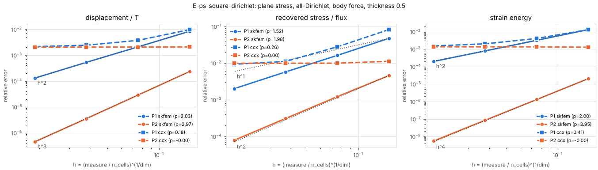

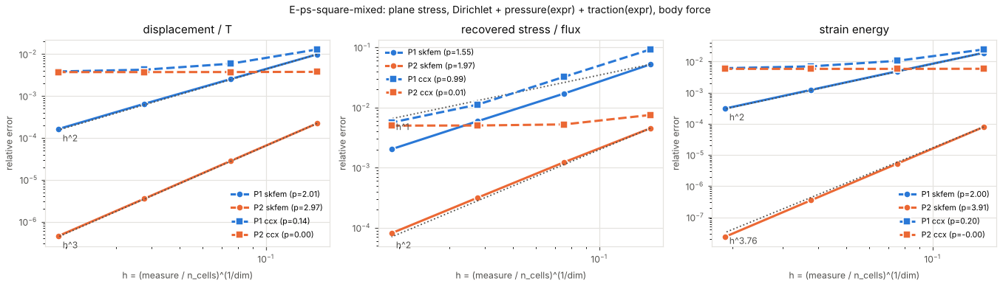

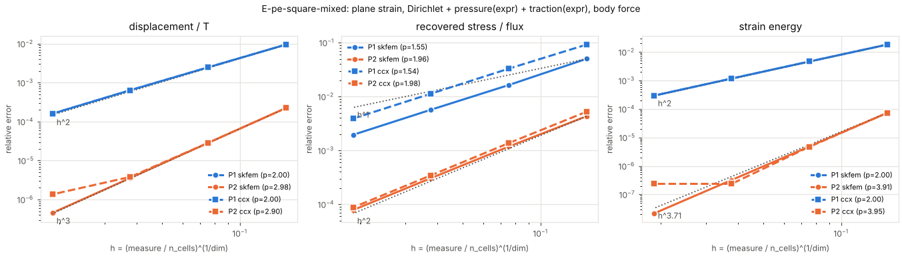

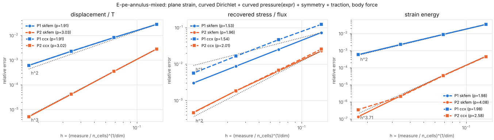

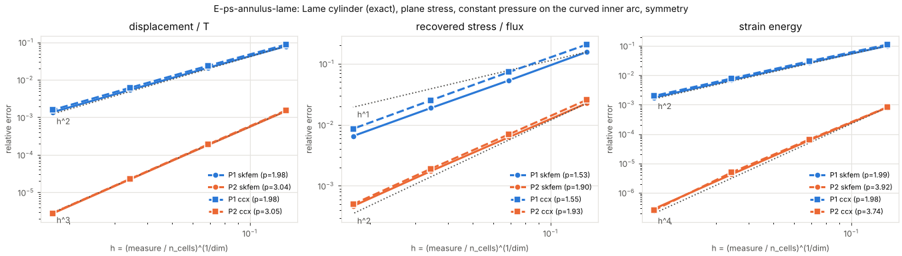

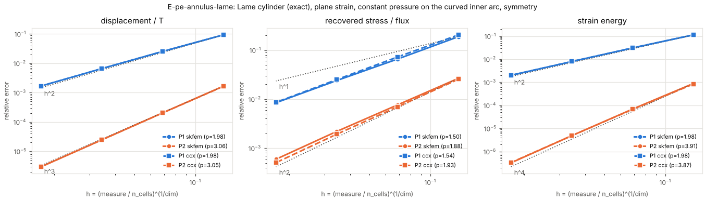

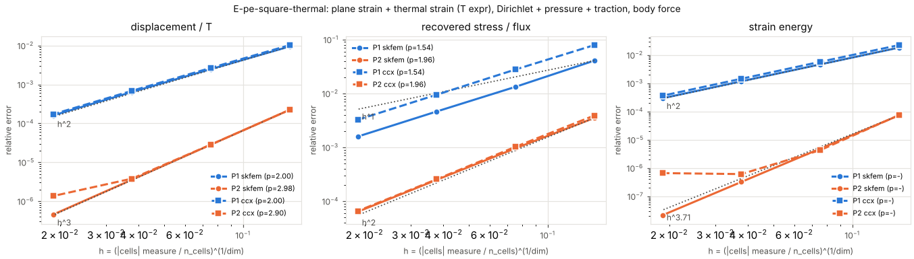

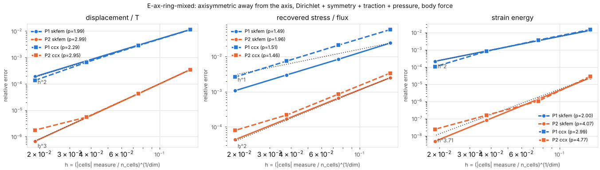

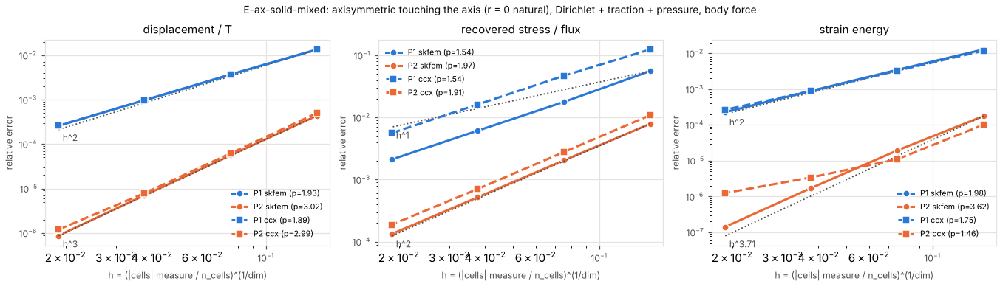

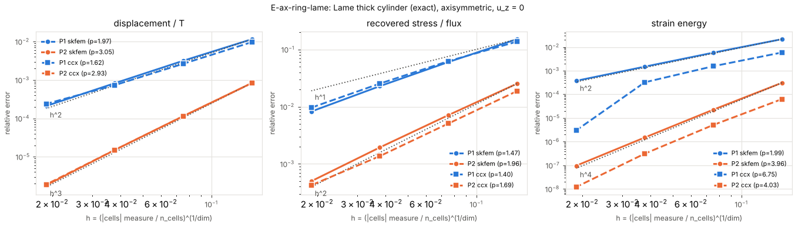

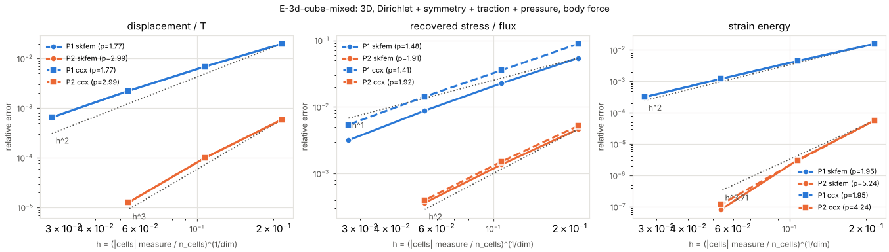

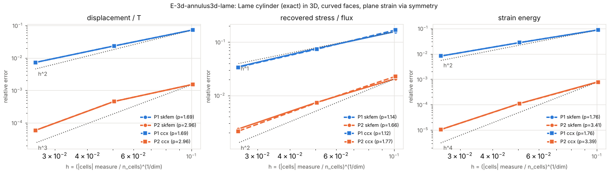

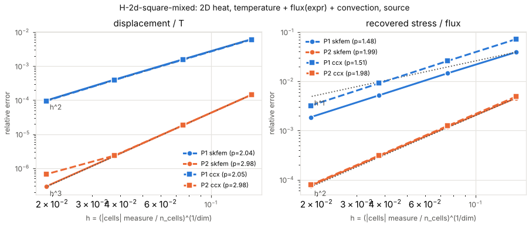

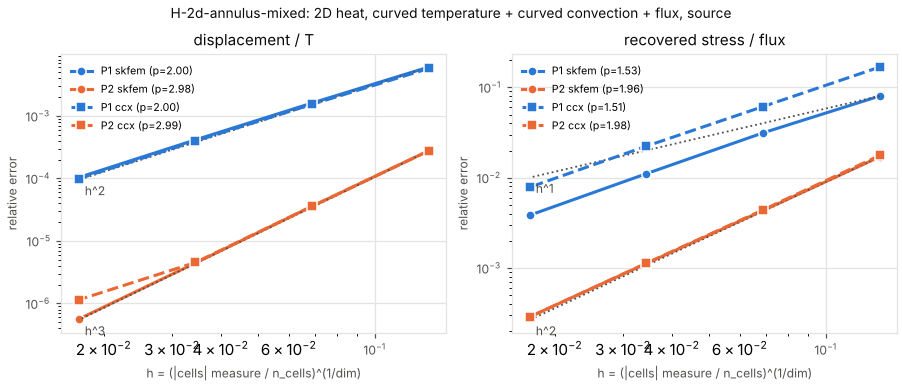

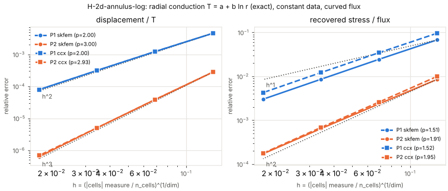

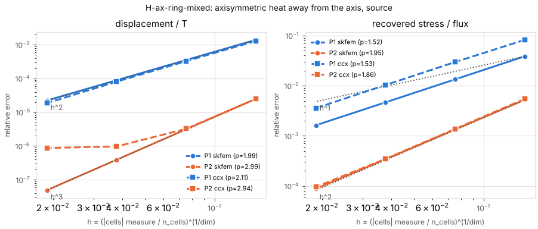

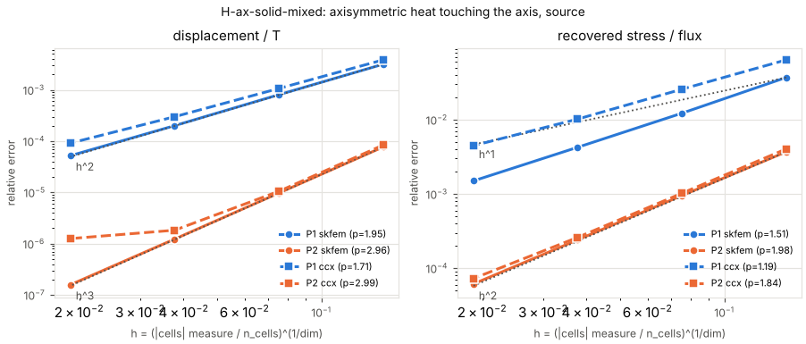

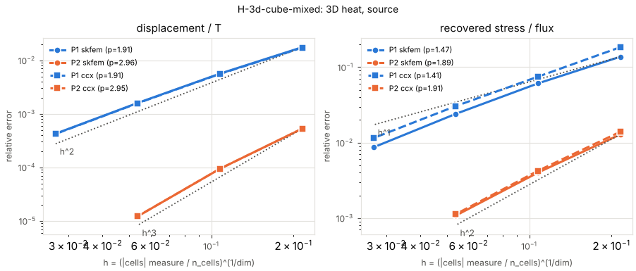

