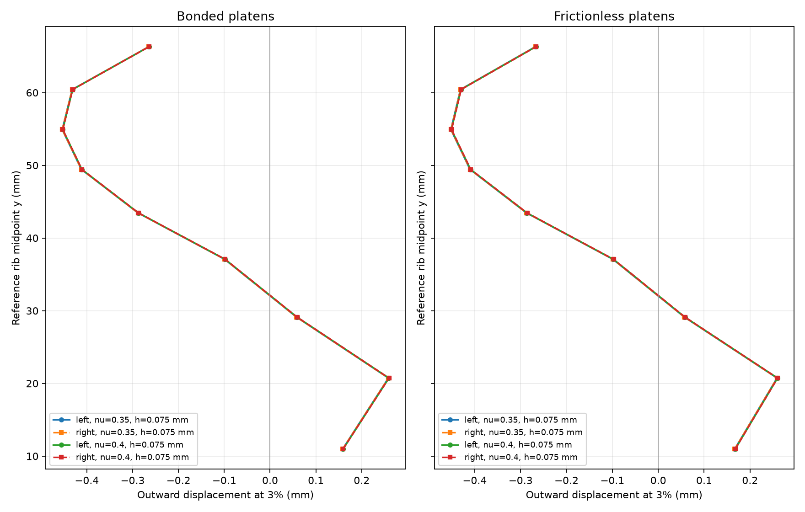
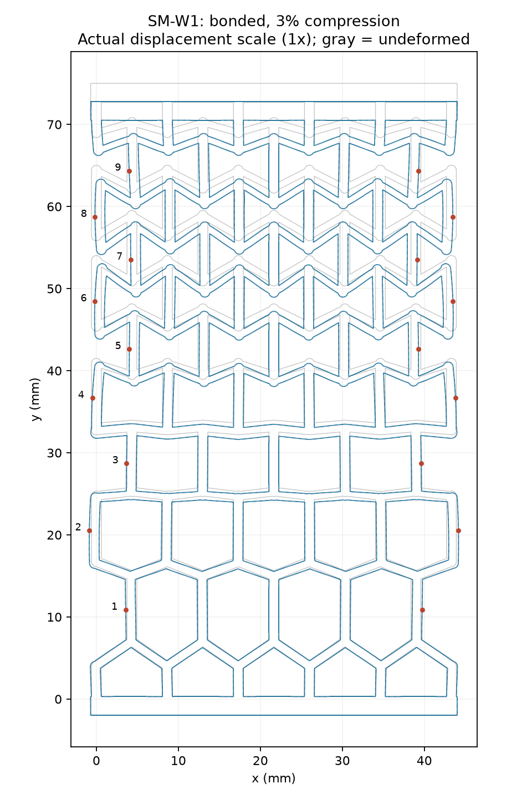

# ScienceClaw SM-W1: independent linear FE comparison

Input-only ScienceClaw geometry/loading; small-strain P2 plane-strain model, depth15mm. No peer predictions, experimental values or photos were read before freezing this package. This is a simulation of the supplied model; experimental agreement is not yet evaluated.

## Model and output definitions

mm/N/MPa; primary E=1670MPa, nu=0.35, sensitivity nu=0.40. Source gauge height73mm gives travel1.095/2.190mm for1.5/3%. Bars remain deformable. Bonded: bottom outer face fixed, top outer face ux=0 and uy=-travel. Frictionless: outer faces prescribed uy, zero tangential traction, one bottom-centre ux anchor; idealised closed-contact rollers, no unilateral detachment or self-contact.

Nine free long exterior vertical ribs, excluding the two half-rows attached to loading bars; midpoint of each straight outer face. Probe coordinates and rib endpoints are in SETUP.json; each is an exact mesh vertex. Positive outward=-ux(left),+ux(right); negative values mean inward. Slight source asymmetry retained.

1.5% results are exactly half the3% linear solution. Forces for E=2230MPa are exactly scaled by2230/1670; these are algebraic consequences of this homogeneous linear model, not separate runs. Actual resin cure state and material law are not inferred.

## Mesh refinement at nu=0.35

| Platens | Target h (mm) | Triangles | DOFs | Force at 3% (N) | Relative residual | Time (s) |
|---|---:|---:|---:|---:|---:|---:|
| bonded | 0.6 | 13459 | 61620 | 697.136146 | 2.82e-15 | 0.93 |
| bonded | 0.3 | 39339 | 170732 | 682.394304 | 3.34e-15 | 2.51 |
| bonded | 0.15 | 132868 | 555842 | 674.939617 | 4.25e-15 | 9.36 |
| bonded | 0.1 | 292759 | 1208248 | 672.527722 | 5.22e-15 | 23.85 |
| bonded | 0.075 | 503182 | 2061162 | 671.257901 | 5.89e-15 | 49.96 |

Last refinement, bonded: force change -1.269821N (-0.1888%); maximum row-output change 0.0007474mm.

| Platens | Target h (mm) | Triangles | DOFs | Force at 3% (N) | Relative residual | Time (s) |
|---|---:|---:|---:|---:|---:|---:|
| frictionless | 0.6 | 13459 | 61620 | 693.950017 | 2.81e-15 | 0.87 |
| frictionless | 0.3 | 39339 | 170732 | 679.299161 | 3.35e-15 | 2.45 |
| frictionless | 0.15 | 132868 | 555842 | 671.892799 | 4.25e-15 | 9.33 |
| frictionless | 0.1 | 292759 | 1208248 | 669.496812 | 5.21e-15 | 23.75 |
| frictionless | 0.075 | 503182 | 2061162 | 668.235497 | 5.90e-15 | 49.30 |

Last refinement, frictionless: force change -1.261315N (-0.1884%); maximum row-output change 0.0008807mm.

Observed changes are not certified error bounds. Boundary geometry is the fixed polygonal STL, not an inferred exact curved design; meshes are not nested. Timing is a single run, not a performance benchmark.

## Finest force and row outputs

| Platens | E (MPa) | nu | h (mm) | Force at 1.5% (N) | Force at 3% (N) | Force at 3%, scaled to E2230 (N) |
|---|---:|---:|---:|---:|---:|---:|
| bonded | 1670 | 0.35 | 0.075 | 335.628951 | 671.257901 | 896.350371 |
| bonded | 1670 | 0.4 | 0.075 | 350.694663 | 701.389326 | 936.585746 |
| frictionless | 1670 | 0.35 | 0.075 | 334.117749 | 668.235497 | 892.314467 |
| frictionless | 1670 | 0.4 | 0.075 | 349.044309 | 698.088618 | 932.178215 |

### Bonded, nu0.35, h0.075mm

| Row | y (mm) | Left outward at 1.5% (mm) | Right at 1.5% | Left at 3% | Right at 3% |
|---|---:|---:|---:|---:|---:|
| 1 | 10.966721 | 0.0790881 | 0.0790781 | 0.1581762 | 0.1581563 |
| 2 | 20.737499 | 0.1290597 | 0.1290930 | 0.2581193 | 0.2581860 |
| 3 | 29.119832 | 0.0287470 | 0.0288047 | 0.0574940 | 0.0576093 |
| 4 | 37.076435 | -0.0497603 | -0.0496929 | -0.0995206 | -0.0993857 |
| 5 | 43.447962 | -0.1442299 | -0.1441792 | -0.2884597 | -0.2883583 |
| 6 | 49.429199 | -0.2060156 | -0.2059697 | -0.4120313 | -0.4119395 |
| 7 | 54.914776 | -0.2269312 | -0.2268938 | -0.4538624 | -0.4537876 |
| 8 | 60.429298 | -0.2160714 | -0.2160564 | -0.4321427 | -0.4321129 |
| 9 | 66.315641 | -0.1325105 | -0.1325112 | -0.2650210 | -0.2650225 |

### Frictionless, nu0.35, h0.075mm

| Row | y (mm) | Left outward at 1.5% (mm) | Right at 1.5% | Left at 3% | Right at 3% |
|---|---:|---:|---:|---:|---:|
| 1 | 10.966721 | 0.0832109 | 0.0832093 | 0.1664218 | 0.1664186 |
| 2 | 20.737499 | 0.1293294 | 0.1293916 | 0.2586588 | 0.2587832 |
| 3 | 29.119832 | 0.0284060 | 0.0285038 | 0.0568120 | 0.0570075 |
| 4 | 37.076435 | -0.0495383 | -0.0494137 | -0.0990767 | -0.0988275 |
| 5 | 43.447962 | -0.1436547 | -0.1435309 | -0.2873094 | -0.2870619 |
| 6 | 49.429199 | -0.2051595 | -0.2050224 | -0.4103190 | -0.4100447 |
| 7 | 54.914776 | -0.2260383 | -0.2258928 | -0.4520765 | -0.4517855 |
| 8 | 60.429298 | -0.2155973 | -0.2154579 | -0.4311946 | -0.4309158 |
| 9 | 66.315641 | -0.1339497 | -0.1338094 | -0.2678995 | -0.2676188 |

## Verification and limitations

The independent affine rectangle test checks the exact plane-strain displacement and reaction E/(1-nu²)*strain*width*depth. Its results are in verification/checks.json. Every panel run checks positive compressive force, free-DOF residual<1e-8, force imbalance<1e-7 and Clapeyron energy/work error<1e-7. Source area matches STL volume/15 to relative1e-9.

Quadrature-level local strains/rotations and the deformed-map determinant are retained per run as diagnostics. Local strain can exceed the nominal platen strain. These values are not failure predictions, and convergence of the linear solution does not validate small-strain kinematics or resin behaviour experimentally. No plasticity, geometric nonlinearity, self-contact, buckling, damage or fracture result is claimed.

For scale, the finest bonded nu0.35 run has quadrature in-plane principal-strain extrema -0.09967 / 0.05767, and maximum absolute linear rotation 0.14626rad. These extrema are mesh-sensitive near joints/corners; a small global mesh change does not establish that geometric or material nonlinear corrections are small.

All rows, both Poisson ratios, reactions, fields, software versions, runtime and process memory are retained. CSV: row_outputs.csv; machine-readable summary: summary.json. Input hashes and all probe coordinates: SETUP.json. Small-strain source and reproduction details: experiments/scienceclaw_honeycomb/README.md. Large field/mesh files are omitted from the compact Git handoff; their hashes are in FIELDS_SHA256SUMS, with copies retained locally and regeneration documented.

Input authorship: ScienceClaw, SM-W1 input-only package, https://alanchen.cc/s/scienceclaw-run2-xteam-feagent-hlyniu5qon4yd7xipr5l/. No input redistribution or new licence is implied.
