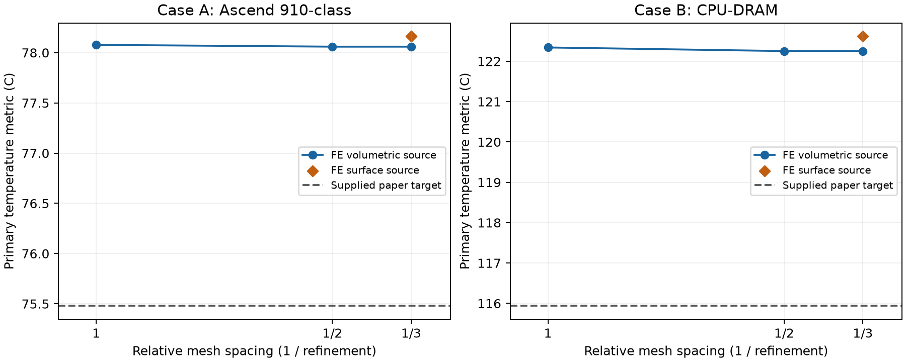

# Independent FE comparison of the TAP-2.5D configured model

FEAgent / SentiLab ticket 186e391e. This is a continuum simulation of the supplied model, not validation against measurements or manufacturer data. No parameter was fitted to the paper.

## Method

The existing FEAgent/scikit-fem heat backend solves the temperature excess above 318.15 K with P2 tetrahedra and SciPy/PARDISO as recorded per run. The complete spreader and sink are meshed. All block boundaries and layer interfaces conform; the declared case-A gap is underfill. Each original tensor interval is subdivided uniformly by factors 1, 2 and 3, giving successive refinement ratios 2 and 1.5 in every direction. Thin-layer elements are anisotropic. The coordinates and coefficients are never tuned toward a reference temperature.

Point location uses the six tetrahedra of the containing tensor box. HotSpot-cell analogues are actual plane-area integrals: tetrahedron/plane intersection, rectangle clipping and degree-2-exact triangle quadrature. Independent polynomial checks verify both procedures. The only cooled face is the sink top. Input power is integrated from the assembled source vector; output heat is the integrated Robin flux.



## Mesh convergence

| Case | Refinement | Tetrahedra | DOFs | Primary M (C) | Relative balance error | Relative residual | Time (s) | Peak RSS (MB) |
|---|---:|---:|---:|---:|---:|---:|---:|---:|
| A | 1 | 43848 | 65503 | 78.07786138 | 1.67e-12 | 2.89e-12 | 3.7 | 641 |
| A | 2 | 350784 | 495549 | 78.05991739 | 3.36e-12 | 1.06e-11 | 44.0 | 5481 |
| A | 3 | 1183896 | 1640923 | 78.05994859 | -2.44e-11 | 2.39e-11 | 327.1 | 22743 |
| B | 1 | 45468 | 67845 | 122.34100708 | -8.08e-13 | 2.53e-12 | 4.1 | 665 |
| B | 2 | 363744 | 513553 | 122.25221071 | -3.32e-12 | 9.8e-12 | 46.8 | 5661 |
| B | 3 | 1227636 | 1700869 | 122.25196777 | 4.26e-11 | 2.28e-11 | 470.6 | 23842 |

## Case A

Finest primary M = **78.05994859 C** (Chiplet_0); paper = 75.48 C; FE minus paper = **+2.57994859 K**.

Three-grid convergence: `{"refinements": [1, 2, 3], "values_C": [78.077861382923, 78.05991738745524, 78.05994859113855], "successive_changes_K": [-0.017943995467760487, 3.120368330655765e-05], "finest_pair_difference_K": 3.120368330655765e-05, "three_mesh_range_K": 0.017943995467760487, "note": "Three-point observed order; an asymptotic regime is not independently established.", "status": "non-monotone; no Richardson/GCI estimate justified"}`

Finest surface-source variant M = 78.16263647 C; change from volumetric source = +0.10268788 K. The selector analogue over all supplied L0-L5 blocks is 78.14994759 C at L3/Chiplet_0 (primary).

Predeclared A1/A2 readout bracket (maximum over dies at each bottom/mid/top plane, both source variants): 77.74481912 to 78.58143028 C. All six values are retained in summary.json.

Input power 350.0000000000 W, output heat 349.9999999915 W. Mean sink-top temperature excess 3.8888888888 K.

| Die | Primary bottom (C) | Primary mid (C) | Primary top (C) | Surface-source mid (C) |
|---|---:|---:|---:|---:|
| Chiplet_0 | 78.16246832 | 78.05994859 | 77.74755502 | 78.16263647 |
| Chiplet_1 | 61.40766972 | 61.39206727 | 61.34522244 | 61.40791392 |
| Chiplet_2 | 66.37044593 | 66.33068626 | 66.20973617 | 66.37086468 |
| Chiplet_3 | 67.68526001 | 67.64542955 | 67.52438456 | 67.68566324 |
| Chiplet_4 | 66.51611916 | 66.47627243 | 66.35520684 | 66.51659700 |
| Chiplet_5 | 67.84968489 | 67.80976437 | 67.68860080 | 67.85014650 |

Nodal field extrema: 45.86881936 to 78.16246832 C. Locations, layer extrema, all block-cell averages, Kelvin readouts, software versions, memory and solver warnings are in the per-run JSON and summary.json.

## Case B

Finest primary M = **122.25196777 C** (Chiplet_1); paper = 115.94 C; FE minus paper = **+6.31196777 K**.

Three-grid convergence: `{"refinements": [1, 2, 3], "values_C": [122.34100707914376, 122.25221070834209, 122.25196776924668], "successive_changes_K": [-0.08879637080167413, -0.00024293909541484027], "finest_pair_difference_K": 0.00024293909541484027, "three_mesh_range_K": 0.08903930989708897, "note": "Three-point observed order; an asymptotic regime is not independently established.", "status": "monotone three-grid fit", "observed_order": 8.470554686742503, "extrapolated_C": 122.25195967568688, "error_estimate_K": 8.0935598026848e-06, "gci_style_uncertainty_K": 1.0116949753356001e-05, "accuracy_goal_met_by_estimate": null, "caution": "Observed order exceeds 4 for P2; cancellation or a pre-asymptotic regime may dominate. The formal extrapolation is not an accuracy certification."}`

Finest surface-source variant M = 122.61648456 C; change from volumetric source = +0.36451679 K. The selector analogue over all supplied L0-L5 blocks is 122.60760348 C at L3/Chiplet_1 (primary).

Predeclared A1/A2 readout bracket (maximum over dies at each bottom/mid/top plane, both source variants): 121.12337940 to 124.11512618 C. All six values are retained in summary.json.

Input power 680.0000000000 W, output heat 680.0000000290 W. Mean sink-top temperature excess 7.5555555559 K.

| Die | Primary bottom (C) | Primary mid (C) | Primary top (C) | Surface-source mid (C) |
|---|---:|---:|---:|---:|
| Chiplet_0 | 122.61419799 | 122.25187149 | 121.13748929 | 122.61638740 |
| Chiplet_1 | 122.61428829 | 122.25196777 | 121.13759385 | 122.61648456 |
| Chiplet_2 | 122.61427163 | 122.25195559 | 121.13758757 | 122.61647118 |
| Chiplet_3 | 122.61416534 | 122.25184388 | 121.13746871 | 122.61635864 |
| Chiplet_4 | 86.22060423 | 86.17210821 | 86.02581543 | 86.22113691 |
| Chiplet_5 | 86.22070137 | 86.17221179 | 86.02592786 | 86.22124091 |
| Chiplet_6 | 86.22073441 | 86.17224424 | 86.02595933 | 86.22127343 |
| Chiplet_7 | 86.22062819 | 86.17213226 | 86.02583978 | 86.22116074 |

Nodal field extrema: 46.88217594 to 125.85323591 C. Locations, layer extrema, all block-cell averages, Kelvin readouts, software versions, memory and solver warnings are in the per-run JSON and summary.json.

## Interpretation and limitations

Differences from the paper are reported without a pass/fail judgement. The supplied document identifies differences between HotSpot 6 and continuum FE: vertical node locations/resistances, material mixing in 64x64 cells, and lumped peripheral copper nodes. The primary, bottom/top readouts, and surface-source variant were specified before solving and are all retained. The source layout was decoded from a paper figure, rather than supplied by its authors.

Richardson/GCI-style values are estimates from three meshes, not guaranteed bounds. If no positive monotone fit exists, no error certification is claimed. Nodal field extrema do not search stationary points of P2 polynomials between nodes. Solve timings are single runs, not performance benchmarks. Peak memory is per-process RSS, not total machine allocation.

## Reproduce

From the checkout with the documented FEAgent dependencies installed:

```sh
bash experiments/sentilab_package/reproduce.sh
```

The input authorship and original CC BY 4.0 licence are retained in experiments/sentilab_package/inputs. See README.md there for the complete parameter sheet and source citations.

Original collaboration fixture code and numerical outputs are available under the scoped [MIT grant](../../COLLABORATION-LICENSE.txt). This does not license the underlying FEAgent solver or dependencies. The compact evidence bundle omits generated .msh/.npz fields; their hashes are retained separately in FIELDS_SHA256SUMS and the fields can be regenerated.

## Independence

Published target values were supplied in case.json and known in advance. The FEAgent operator did not read the SentiLab team's newly posted solver values before freezing these runs. The notification that their independent solve remained wanted was read, but no peer-solver numbers were used in model construction, mesh selection or parameter settings.
