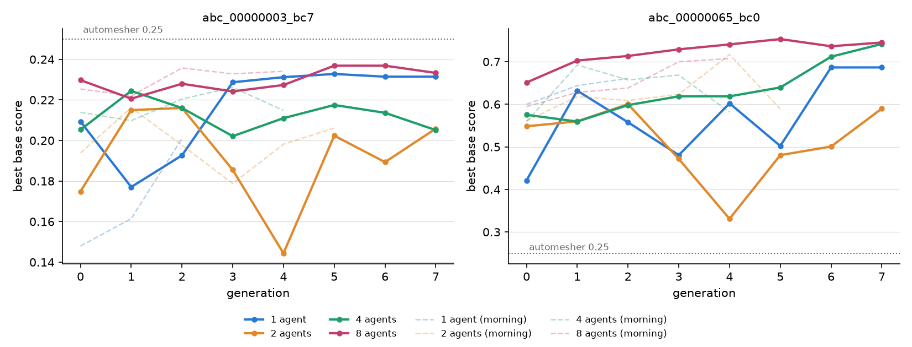

# Swarm size with diversity mechanisms on hard 3D CAD problems (gold ABC parts), 2026-10-31 (afternoon)

Follow-up to `results/scaling_gold_2026-10-31/` (the "morning" runs), whose agents converged on
near-identical meshes. Same pipeline and tasks (`abc_00000003_bc7`, `abc_00000065_bc0`): `--deep --split`
(Opus teacher, self-reflection, organizer), field-mode score against the gmsh-default automesher, Sonnet
agents. New in these runs:

- **Teacher-assigned roles** (`ace/deep_teacher.py` `allocate()`): on a task with 2+ agents the best run's
  agent is the *control* (re-run the best recipe, measures noise), the next are *variants* (the best recipe
  with exactly one factor changed) and the lowest-ranked third are *explorers* (a structurally different
  mesh). With 1 agent per task there are no roles.
- **Personas** for some agents (`--persona-count`: 4 of 8, 2 of 4, 1 of 2).
- **Diversity bonus** +0.1 for a run whose recipe differs structurally from every other run of its
  generation and scores within a margin of the best (`ace/checks.py`).
- 8 generations each (the morning runs were stopped after 3-6).

The single agent (`ace/single_loop.py`, Sonnet, high effort) does both tasks in one memory, with the
8-agent swarm's solve budget and its per-generation time. **Base score** excludes all bonuses: 1.0 = 2x
the automesher's accuracy at its DOFs, and **the automesher itself scores 0.25**. Per-generation numbers:
`scores.json`. Run folders: `ace_runs/div_s1|s2|s4|s8` on the author's laptop. Trained swarms, ready for
`python -m ace.infer`: `results/trained_swarms/div_s*`.

## Summary over generations 1-7

| run | bc7: mean of per-gen best | bc7: mean | 65_bc0: mean of per-gen best | 65_bc0: mean | 65_bc0: max | API $ |
|---|---|---|---|---|---|---|
| 1 agent (Sonnet) | 0.218 | 0.218 | 0.592 | 0.592 | 0.686 | 13.94 |
| 2 agents | 0.194 | 0.194 | 0.505 | 0.505 | 0.600 | 12.76 |
| 4 agents | 0.213 | 0.203 | 0.641 | 0.626 | 0.742 | 21.34 |
| 8 agents | **0.230** | **0.223** | **0.731** | **0.685** | **0.753** | 41.45 |

Total $89.49. 0 invalid runs in any of the four.

## Best base score per generation (bc7 / 65_bc0)

| run | gen 0 | gen 1 | gen 2 | gen 3 | gen 4 | gen 5 | gen 6 | gen 7 |
|---|---|---|---|---|---|---|---|---|
| 1 agent | 0.21 / 0.42 | 0.18 / 0.63 | 0.19 / 0.56 | 0.23 / 0.48 | 0.23 / 0.60 | 0.23 / 0.50 | 0.23 / 0.69 | 0.23 / 0.69 |
| 2 agents | 0.18 / 0.55 | 0.22 / 0.56 | 0.22 / 0.60 | 0.19 / 0.47 | 0.14 / 0.33 | 0.20 / 0.48 | 0.19 / 0.50 | 0.21 / 0.59 |
| 4 agents | 0.21 / 0.58 | 0.22 / 0.56 | 0.22 / 0.60 | 0.20 / 0.62 | 0.21 / 0.62 | 0.22 / 0.64 | 0.21 / 0.71 | 0.21 / 0.74 |
| 8 agents | 0.23 / 0.65 | 0.22 / 0.70 | 0.23 / 0.71 | 0.22 / 0.73 | 0.23 / 0.74 | 0.24 / 0.75 | 0.24 / 0.74 | 0.23 / 0.75 |

Mean base score per agent, 65_bc0 (does the typical agent improve?): 8 agents 0.55, 0.61, 0.63, 0.68,
0.72, 0.73, 0.68, 0.73; 4 agents 0.55, 0.54, 0.60, 0.61, 0.61, 0.62, 0.68, 0.73.

## Against the automesher

| task | automesher | best agent run |
|---|---|---|
| bc7 | 31.9% field error at 6,057 DOFs (score 0.25) | 16.3% at 24,375 DOFs (score 0.237) |
| 65_bc0 | 24.1% at 8,811 DOFs (score 0.25) | 8.4% at 16,713 DOFs (score 0.753) |

Below the 2x target the score is g^2 / (4c) (g = accuracy gain, c = DOF cost), so a run beats the automesher
only if g > sqrt(c). On 65_bc0 every valid run but one beats it, the best by 3x. **On bc7 no run in either
study beats it**: the best halves the error but needs 4x the DOFs (95% of break-even). bc7's stress
singularities make error fall slowly with DOFs unless the grading toward the singular edges is efficient.

## What the data shows (and does not)

- **More agents, better and steadier learning, most clearly with 8.** The 8-agent swarm leads on both
  tasks and on 65_bc0 improves almost every generation, best 0.65 to 0.75 and the mean agent 0.55 to
  0.73. That rise in the mean is learning, not just a best-of-more-draws effect. With 1 agent per task
  (2-agent swarm, single agent) a generation is a single sample and scores swing by up to 0.3.
- **The 4-agent swarm learned late:** flat around 0.60 for five generations on 65_bc0, then 0.71 and 0.74
  (mean agent 0.73) in generations 6-7. The morning 4-agent run, stopped at generation 4, could not show this.
- **On bc7 the team-size advantage is mostly more draws.** The ordering by size is already there in
  generation 0, before any learning, and the mean agent barely moves for any team size.
- **The single agent** (8-agent budget and time, 1/3 of the cost) learned bc7 to the swarm's level
  (0.229-0.233 from generation 3 on, vs 0.22-0.24) but stayed lower and noisy on 65_bc0 (best 0.686).
  It beat the 2-agent swarm on both tasks, but it had more solves and time per task than those agents.
- **Diversity mechanisms vs the morning runs, same generations 1-4** (mean of per-gen best, bc7 / 65_bc0):
  8 agents 0.225 / **0.721** vs 0.231 / 0.668; 4 agents 0.213 / 0.599 vs 0.218 / 0.650; 2 agents
  0.190 / 0.491 vs 0.198 / 0.642. They helped only where the roles fully apply (4 agents per task:
  control, variants and explorer) and on the task with room to improve. With 2 per task there was no
  gain, and with 1 per task (no roles) the 2-agent run was worse, within this study's run-to-run noise:
  its worst runs came from the agent without a persona, which spent more DOFs at the same error.
- **Counting diversity:** the structural test behind the bonus treats a variant (one factor changed by a
  moderate amount) as the same recipe, so with roles a task shows about 2 distinct recipes per
  generation (control and variants together, plus the explorer) even when 4 different experiments ran.
  Over all generations: 8 agents 13-14 distinct recipes in 32 runs (morning: 13 in 20).
- **Limits:** one run per configuration; noise between repeats is 0.03-0.1 per generation. The
  1- and 2-agent runs were restarted once after a teacher bug fix (commit 8e4fe3f); their first attempts
  are in `ace_runs/div_s1_bug`, `div_s2_bug` and are not used here.

