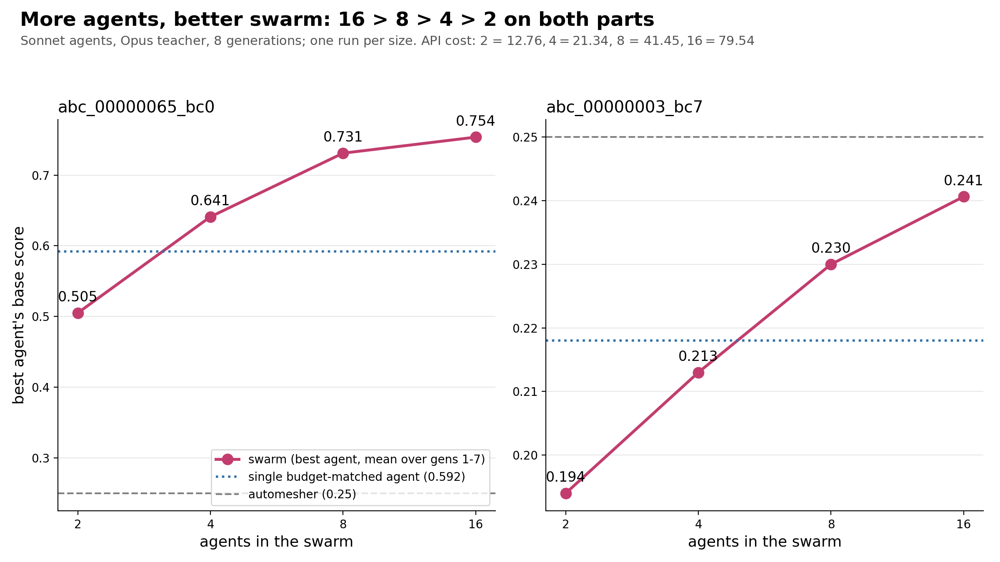

# Swarm size, extended to 16 agents (2026-11-01)

Extends `results/diversity_gold_2026-10-31/` (1, 2, 4 and 8 agents) with one 16-agent run. The same
pipeline and tasks (`abc_00000003_bc7`, `abc_00000065_bc0`) were used: `--deep --split`, personas on half
the agents (8 of 16), field-mode score against the gmsh-default automesher, 8 generations, Sonnet agents,
and an Opus teacher.

```
ACE_SCORE=field python -m ace.run_loop --deep --split --memory shared+private --agents 16 \
  --persona-count 8 --problems abc_00000003_bc7,abc_00000065_bc0 --holdout "" --generations 8 \
  --budget-usd 85 --concurrency 10 --out ace_runs/div_s16
```

## Summary over generations 1-7 (same measures as the 1-8 table)

| run | bc7: mean of per-gen best | bc7: mean | 65_bc0: mean of per-gen best | 65_bc0: mean | 65_bc0: max | API $ |
|---|---|---|---|---|---|---|
| 1 agent (Sonnet, budget-matched) | 0.218 | 0.218 | 0.592 | 0.592 | 0.686 | 13.94 |
| 2 agents | 0.194 | 0.194 | 0.505 | 0.505 | 0.600 | 12.76 |
| 4 agents | 0.213 | 0.203 | 0.641 | 0.626 | 0.742 | 21.34 |
| 8 agents | 0.230 | 0.223 | 0.731 | 0.685 | 0.753 | 41.45 |
| **16 agents** | **0.241** | **0.228** | **0.754** | **0.691** | **0.794** | **79.54** |

Best per generation, 16 agents (gens 0 → 7):
- 65_bc0: 0.639, 0.714, 0.709, 0.749, 0.747, 0.775, 0.787, 0.794. It rose in 5 of 7 steps.
  The max of 0.794 is 3.2x the automesher, at 8.7% field error and 15,465 DOFs.
- bc7: 0.231, 0.221, 0.233, 0.247, 0.247, 0.244, 0.246, 0.245. The best was 0.247, still just under the
  automesher's 0.25.

Spend by role: generator $24.47, teacher (Opus) $42.76, reflect $5.20, organizer $7.11.
1,563 API calls. 0 failed and 0 errored runs.



## What the data shows (and does not)

- **The order extends to 16 > 8 > 4 > 2 on both tasks,** for the best agent and for the mean agent.
- **The returns diminish.** On 65_bc0, going from 4 to 8 agents gained +0.090 and going from 8 to 16 gained
  +0.023, for about 1.9x the cost. On bc7 the steps are +0.017 and +0.011.
- **The 16-agent swarm learns steadily on 65_bc0.** Its best reached a new high in gens 5, 6 and 7
  (0.775 → 0.787 → 0.794), which is the highest score in any run so far.
- **bc7 is still below the automesher** (best 0.247 < 0.25). This is the hard part for every team size.
- **Caveats.**
  - There is one run per size, and run-to-run noise is about 0.03-0.1 per generation.
  - The field references (`ace/field_refs/abc_*`) were rebuilt for this run with `ace.gold_reference`
    from the same study meshes. The original author's cached files were not available. The final level
    aims 3% under the 4.5M-DOF cap (commit 603f3e7), so the 16-agent scores may differ slightly in
    scale from the 1-8 runs.

Per-generation numbers: `scores.json`. The trained swarm, ready for `python -m ace.infer`, is in
`results/trained_swarms/div_s16`. The run folder `ace_runs/div_s16` is gitignored and stays on the
laptop.
