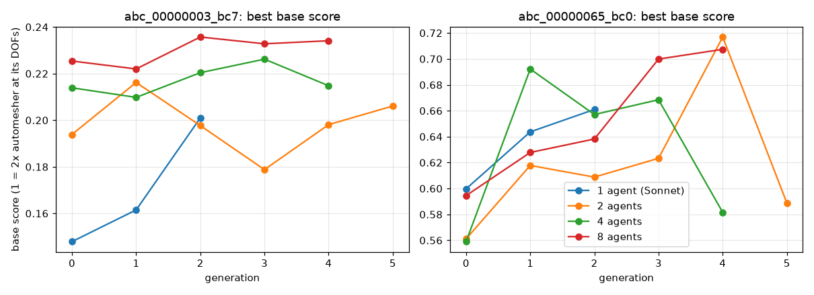

# Swarm size on hard 3D CAD problems (gold ABC parts), 2026-10-31

Same pipeline with 1, 2, 4 and 8 Sonnet agents on the same two tasks (`abc_00000003_bc7`, `abc_00000065_bc0`): `--deep` (Opus teacher, self-reflection, organizer), field-mode score against the gmsh-default automesher, and the agents' upgraded mesh tools (curved-cell repair, geometry info, solve feedback, view, compare). 8/4/2 agents: random split over the 2 tasks every generation (4/2/1 per task). 1 agent: one memory, both tasks in parallel. **Base score** excludes the be-the-best bonus, so it is comparable across team sizes (1.0 = 2x the automesher's accuracy at its DOFs). Runs were stopped by choice after 3-6 generations, because agents had converged on near-identical meshes. Full run folders (traces, meshes, contexts): `ace_runs/scale_s1|s2|s4|s8` on the author's laptop; per-generation numbers: `scores.json`.

## Summary over generations 1+ (after learning starts)

| run | bc7: mean of per-gen best | bc7: mean | 65_bc0: mean of per-gen best | 65_bc0: mean | 65_bc0: max | API $ |
|---|---|---|---|---|---|---|
| 1 agent (Sonnet) | 0.181 | 0.181 | 0.652 | 0.652 | 0.66 | 3.72 |
| 2 agents | 0.199 | 0.199 | 0.631 | 0.631 | 0.72 | 8.69 |
| 4 agents | 0.218 | 0.213 | 0.650 | 0.631 | 0.69 | 15.52 |
| 8 agents | 0.231 | 0.222 | 0.668 | 0.624 | 0.71 | 27.41 |

## Best base score per generation (bc7 / 65_bc0)

| run | gen 0 | gen 1 | gen 2 | gen 3 | gen 4 | gen 5 |
|---|---|---|---|---|---|---|
| 1 agent (Sonnet) | 0.15 / 0.60 | 0.16 / 0.64 | 0.20 / 0.66 | – | – | – |
| 2 agents | 0.19 / 0.56 | 0.22 / 0.62 | 0.20 / 0.61 | 0.18 / 0.62 | 0.20 / 0.72 | 0.21 / 0.59 |
| 4 agents | 0.21 / 0.56 | 0.21 / 0.69 | 0.22 / 0.66 | 0.23 / 0.67 | 0.21 / 0.58 | – |
| 8 agents | 0.23 / 0.59 | 0.22 / 0.63 | 0.24 / 0.64 | 0.23 / 0.70 | 0.23 / 0.71 | – |

Automesher baselines: bc7 31.9% field error at 6,057 DOFs (2x target: 16%); 65_bc0 24.1% at 8,811 DOFs (target 12.1%).

## What the data shows (and does not)

- **bc7 (the harder part): more agents is better at every size.** Mean of the per-generation best: 0.181 (1) < 0.199 (2) < 0.218 (4) < 0.231 (8); the per-generation mean orders the same way.
- **65_bc0:** the 8-agent swarm has the highest mean of per-generation bests (0.668 vs 0.631-0.652), but the per-generation *mean* is flat across sizes (0.624-0.652) and the single highest score was the 2-agent run's 0.72 (gen 4, then 0.59 in gen 5): noisy.
- **Mechanism seen in the 8-agent run:** on 65_bc0 one agent (a7, gen 1) tried stacked boxes + a fine refinement of edge e22 and got 7.0% field error vs 10.7-11.4% for its peers; all agents on that task adopted it in gen 2 (7.4-8.7%). Exploration by one agent, spread by the teacher and shared notes.
- **Limits:** one run per team size, 3-6 generations, 1-4 runs per task per generation; the single agent has only 2 learning generations. Differences of a few hundredths are within run-to-run noise; the bc7 ordering is the most consistent signal.
- **Why we stopped:** within a generation all agents used nearly the same recipe (same order, h within ±10%, same refinement targets). Next: personas for half the agents, teacher-assigned experiments, and a bonus for structurally different meshes.
- 0 invalid runs after the curved-cell repair (before it, every swarm run on 65_bc0 was invalid).

