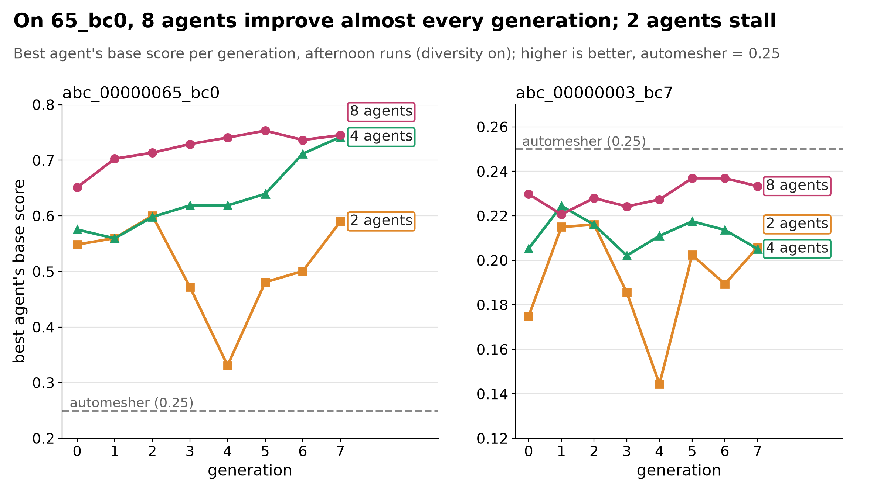
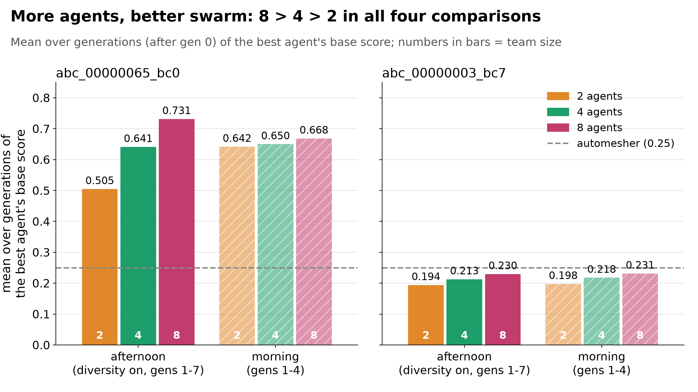

# Self-improving meshing agents: the results, in three acts

A swarm of LLM agents learns to mesh finite-element problems. Each generation, the agents mesh, the fixed
solver scores each mesh against a reference, and a teacher (Opus) plus each agent's own reflections update a
shared playbook. This folder collects the results as a talk narrative:

1. Agentic meshing works, and training works (NAFEMS-style benchmarks).
2. Swarms train better and more stably, and this scales (gold ABC CAD parts).
3. The harness learns from real lab data (a 3D-printed part crushed on an Instron).

Every number below is computed from raw files in `ace_runs/`, `physical_tests/` or the act folders' data files,
which are named next to each number. One run per configuration throughout: there are no repeats or confidence
intervals. See the caveats in each act.

**Score used in Acts 1 and 2** (field mode, `checks.base_score`). g = e_auto / e is the accuracy gain over gmsh's
default mesh (the "automesher"). accuracy = (g/2)^2 below g = 2 and g/2 above it; score = accuracy x (automesher
DOFs / own DOFs). The automesher scores 0.25 by construction, and 1.0 means 2x its accuracy at its DOFs.

---

## Act 1: agentic meshing works, and training works

**KEY ACT 1 EXAMPLE (chosen by the user):** `equal_budget/fig_cook_equal_stress.png` (solved von Mises stress, Cook's membrane, equal DOF budget): automesher refined to 734 DOFs, 3.63 % error | early agent 898 DOFs, 2.90 % | trained agent (deep1 g10 a7) 710 DOFs, 1.07 % | true solution. The trained agent wins on both accuracy and DOFs: 3.4x more accurate than the automesher at the same budget. Companion slide: `equal_budget/fig_cook_same_budget.png` (error maps, "Same budget, 3.4x more accurate").


**Claim.** On Cook's membrane, trained agents reach 4.5x the automesher's score: 3.4x lower error at the same
DOFs, or the same error with 10.8x fewer DOFs. Over 10 generations, the mean agent rises from 0.318 to 1.095.


[fig1_learning_curves](act1_agentic_works/fig1_learning_curves.md): "Training works: the mean agent climbs 1.3x → 4.4x
the automesher (Cook)" (gen-0 mean 0.318 = 1.3x; gen-10 mean 1.095 = 4.4x; the best agent ends at 1.126 = 4.5x).


[fig3b_equal_cost_equal_accuracy](act1_agentic_works/fig3b_equal_cost_equal_accuracy.md): "Matching the best agent
costs the automesher up to 11x the DOFs".

Other Act 1 figures:
- [fig2_error_vs_dofs](act1_agentic_works/fig2_error_vs_dofs.md) ([png](act1_agentic_works/fig2_error_vs_dofs.png)):
  "2D: the best agents beat the automesher's whole cost curve; 3D: a tie".
- [fig3_headline_scores](act1_agentic_works/fig3_headline_scores.md) ([png](act1_agentic_works/fig3_headline_scores.png)):
  "The best agent scores 1.6-4.5x the automesher on every benchmark".
- [fig4_mesh_before_after](act1_agentic_works/fig4_mesh_before_after.md) ([png](act1_agentic_works/fig4_mesh_before_after.png)):
  "Same part, same solver: the trained agent grades the mesh into the corners".
- [fig1b_learning_curves_all_runs](act1_agentic_works/fig1b_learning_curves_all_runs.md) ([png](act1_agentic_works/fig1b_learning_curves_all_runs.png)):
  backup slide, "The deep loop learns steadily; the basic loop plateaus or drifts".

**Which "about 4x" is true** (Cook's membrane, `ace_runs/deep1`, best run `gen10/runs/g10-cooks_membrane-a7.json`):

| statement | number |
|---|---|
| best agent's score / automesher's 0.25 | **4.50x** (1.126) |
| last-generation mean agent's score / 0.25 | 4.38x (1.095) |
| accuracy gain g = e_auto / e, best run | 4.76x (1.07% vs 5.11%), but at 2.11x the DOFs (710 vs 336) |
| lower error at the **same DOFs** (automesher refined uniformly) | **3.4x** (1.07% vs 3.69% at 710 DOFs) |
| DOFs the automesher needs for the **same error** | **10.8x more** (7,690 vs 710) |
| mean agent, gen 0 -> gen 10 | 0.318 -> 1.095 (best agent 0.347 -> 1.126) |

So "4x" holds as the score ratio and as the raw error ratio. Both compare against the *unrefined* automesher. The
cost-fair statements are 3.4x lower error at equal DOFs, or 10.8x fewer DOFs at equal error.

Best run on each problem (`act1_agentic_works/act1_numbers.json`, `automesher_sweep.json`):

| problem | best run | score ratio | lower error, same DOFs | fewer DOFs, same error |
|---|---|---|---|---|
| Cook's membrane | deep1 g10-a7 | 4.50x | 3.4x | 10.8x |
| NAFEMS LE1 | split1 g5-a2 | 4.25x | 2.3x | 2.7x |
| LE11 axisymmetric | deep1 g10-a4 | 3.52x | 2.4x | 5.0x |
| LE11 3D | le11 g6-a4 | 1.57x | 1.06x | 1.11x (no real gain) |

**Caveats**
- **Sustained learning shows only in the deep loop (`deep1`, with the Opus teacher).** The cheaper basic loop (no
  teacher) behaves differently:
  - Cook improves early (mean 0.449 -> 0.700 in cook_auto, 0.392 -> 0.711 in split1, gen 0 -> 19), then plateaus
    at about 0.71 for about 10 generations.
  - LE1 has no trend: the last-generation mean, 0.487, is below gen 0's 0.782.
  - LE11 3D is flat.
  - LE11 axisymmetric keeps falling back into a temperature-field setup bug (33 of 57 runs).
- **deep1's LE11-axisymmetric jump from gen 0 to gen 1 is a setup fix, not meshing.** All 4 gen-0 agents wrote the
  wrong temperature field. The mesh-only learning there is gen 1 -> 10: best agent 0.706 -> 0.880, mean 0.678 -> 0.845. On Cook, the whole gen 0 -> 10 gain is
  meshing.
- **The same-DOFs and same-error baseline is gmsh refined uniformly**, computed for this talk
  (`automesher_sweep.py`). An expert, or gmsh with size fields, would do better than this baseline.
- **Lamé was never run in field mode,** so it is not part of Act 1. The NAFEMS problems scored against the
  automesher are LE1, LE11 axisymmetric and LE11 3D; the "4x" comes from Cook's membrane, not from a NAFEMS
  problem (LE1's best is 4.25x).
- **The best runs on LE1 and LE11 3D are isolated early peaks.** LE1's highest-gain run (g = 6.40) hits the
  scorer's 0.5% error floor.

---

## Act 2: swarms train better and more stably, and this scales

**Claim.** On the gold part abc_00000065_bc0, the 8-agent swarm's best agent improves in 6 of 7 generations and
never drops by more than 0.017. The 2-agent swarm falls back by up to 0.141. Averaged over the generations after gen 0
(gens 1-7 afternoon, 1-4 morning), the best agent's score is ordered 8 > 4 > 2 agents in all four comparisons
(2 studies x 2 tasks). The 8-agent swarm
also beats a single budget-matched agent on 65_bc0.



[fig1_best_per_gen](act2_swarms_scale/fig1_best_per_gen.md) (headline): "On 65_bc0, 8 agents improve almost every
generation; 2 agents stall".



[fig2_mean_best_by_team_size](act2_swarms_scale/fig2_mean_best_by_team_size.md): "More agents, better swarm:
8 > 4 > 2 in all four comparisons".


[fig5_swarm_vs_single](act2_swarms_scale/fig5_swarm_vs_single.md): "8 agents beat one budget-matched agent on 65_bc0
and tie on bc7".

Other Act 2 figures:
- [fig4_mean_agent_per_gen](act2_swarms_scale/fig4_mean_agent_per_gen.md) ([png](act2_swarms_scale/fig4_mean_agent_per_gen.png)):
  "Not just more draws: the average agent learns too (0.55 -> 0.73 with 8 agents)".
- [fig6_cost_per_gen](act2_swarms_scale/fig6_cost_per_gen.md) ([png](act2_swarms_scale/fig6_cost_per_gen.png)):
  "Cost grows sub-linearly: 4x the agents cost 3.3x per generation".
- [fig1b_best_per_gen_with_morning](act2_swarms_scale/fig1b_best_per_gen_with_morning.md) ([png](act2_swarms_scale/fig1b_best_per_gen_with_morning.png)):
  backup, the same plot with the morning runs dashed.

Key numbers on abc_00000065_bc0, afternoon runs (`ace_runs/div_s{1,2,4,8}`, 8 generations each; `act2_swarms_scale/data.json`):

| team | best agent, gen 0 -> 7 | mean of best, gens 1-7 | steps up / down / flat | largest drop | std of best | API $ |
|---|---|---|---|---|---|---|
| 8 agents | 0.651 -> 0.745 (max 0.753) | 0.731 | 6 / 1 / 0 | -0.017 | 0.033 | 41.45 |
| 4 agents | 0.575 -> 0.742 | 0.641 | 5 / 1 / 1 | -0.016 | 0.064 | 21.34 |
| 2 agents | 0.548 -> 0.590 (low 0.331 at gen 4) | 0.505 | 5 / 2 / 0 | -0.141 | 0.087 | 12.76 |
| 1 agent, budget-matched | | 0.592 | 3 / 3 / 1 | -0.100 | 0.098 | 13.94 |

In physical terms, the best 65_bc0 mesh (div_s8 gen 5, a1) has 8.4% field error at 16,713 DOFs. The automesher
has 24.1% at 8,811 DOFs. That is 2.86x more accurate for 1.90x the DOFs, and a score of 0.753 = 3.0x the
automesher's.

**Caveats**
- **bc7 (abc_00000003_bc7) is below the automesher for every team.** The best of all nine runs is 0.237, against
  the automesher's 0.25. The 8 > 4 > 2 order on bc7 is already there in gen 0, before any learning.
- **"Budget-matched" means the same solves, turns and time per generation, not the same dollars.** The single
  agent cost $13.94, against $41.45 for the swarm. It is a Sonnet agent with the whole swarm's budget, so it is
  "bigger" but not a stronger model. Only `scale_s1_opus` (morning, 3 generations) uses an Opus agent.
- **The morning runs (`scale_*`, 3-6 generations) don't repeat swarm-vs-single on 65_bc0.** Over gens 1-2 the
  single Sonnet agent's best is 0.652, against 0.633 for the 8-agent swarm.
- **Run-to-run noise is about 0.03-0.1 per generation** (estimated in the afternoon README). The morning 65_bc0
  ordering (0.642 / 0.650 / 0.668) is well inside that noise.
- **The Opus teacher is the largest cost in every afternoon run** (8 agents: $23.09 teacher, $12.51 agents).

---

## Best agent vs average agent

The question: what changes if we take the best agent instead of the average agent? "Best" is the highest base score
among a team's runs on a task in one generation; "average" is the mean over them. A team of n agents puts n/2 runs on
each task, so for 2 agents (and the single agent) best = average. The table shows the mean over generations 1+
(computed by `readme_numbers.py`, which writes `readme_numbers.json`; source `ace_runs/<run>/gen*/runs/*.json`;
invalid runs count as 0).

| study | task | 1 agent | 2 agents | 4 agents best / avg | 8 agents best / avg | 8 > 4 > 2 with best | with average |
|---|---|---|---|---|---|---|---|
| afternoon, gens 1-7 | 65_bc0 | 0.592 | 0.505 | 0.641 / 0.626 | **0.731** / 0.685 | yes | yes |
| afternoon, gens 1-7 | bc7 | 0.218 | 0.194 | 0.213 / 0.203 | **0.230** / 0.223 | yes | yes |
| morning, gens 1-4 | 65_bc0 | 0.652 (gens 1-2) | 0.642 | 0.650 / 0.631 | **0.668** / 0.624 | yes | **no: flat, slightly reversed (0.642 / 0.631 / 0.624)** |
| morning, gens 1-4 | bc7 | 0.181 (gens 1-2) | 0.198 | 0.218 / 0.213 | **0.231** / 0.222 | yes | yes |

What changes when we use the best agent:
- **The ordering 8 > 4 > 2 holds in all four cases.** With the average agent it holds in three. The exception is
  the short morning study on 65_bc0, where the three averages lie within 0.018 of each other (inside the noise),
  with 8 agents nominally lowest.
- **The gap widens.** Afternoon 65_bc0, 8 vs 2 agents: +0.226 with the best agent, +0.180 with the average one.
  The best-minus-average margin of the 8-agent swarm is 0.047 there (afternoon) and 0.044 (morning).
- **Against the single agent,** the afternoon 8-agent swarm wins on 65_bc0 either way (best 0.731 or average
  0.685, against 0.592). On bc7 the margin is small either way (best 0.230, average 0.223, against 0.218), and the single agent
  matches the swarm from gen 3 on, so fig5 calls bc7 a tie.
- **The average agent also learns,** so the gain is not only a best-of-more-draws effect. In div_s8 on 65_bc0 the
  average agent rises 0.550 -> 0.733 (gen 0 -> 7).

Why the best is a fair measure here: the swarm is trained and deployed together, so its best mesh is the output.
**Caveat:** in these runs the best mesh is picked with the hidden reference score, as `ace_runs/gold_single/compare.md`
notes ("an oracle the single agent does not have"). In deployment the swarm would need a reference-free way to pick
its best mesh (e.g. an error estimate). Until that exists, show the average-agent numbers as the selection-proof
backup.

---

## Act 3: the harness learns from real lab data

**Claim.** We 3D-printed the abc_00000065 C-bracket and crushed it on an Instron. Before post-training (the
solvers and the swarm were already capable, but nothing was learned from this test) the simulation is **33 % off
the real test**. With the test conditions learned from the experiment (sticking platens, seating gap, load-train
compliance; then frozen), gmsh's default mesh is 7.8 % off and the swarm's pre-trained mesh 4.6 %. After
post-training the swarm on the real test (`ace_runs/nl_ft`, 10 generations x 4 agents), its most accurate mesh is
**2.0 % off** (1.97 % at 8,753 nodes), 4.0x more accurate than the automesher. The swarm's score rises over the
run: best 0.668 -> 0.892 (2.7x -> 3.6x the automesher's 0.25), average agent 0.572 -> 0.880.

The post-trained simulation also points at the right place for the crack: the real part cracked at the lower inner
bore (observed by the team), where the after-post-training simulation's tension peaks (43 MPa at the real crack's
travel, 85 % of the dogbone strength, 50.5 MPa). The before simulation predicted a crack at the prong tops, 1.6 kN
earlier than the real one (3.16 kN vs 4.76 kN). Details: `act3_real_data/break/index.html` and `break/break.json`.


[fig3_setup_ladder](act3_real_data/fig3_setup_ladder.md): "From 33 % to 2.0 % off the real test: test conditions,
then post-training".


[fig7_post_training_progress](act3_real_data/fig7_post_training_progress.md): "Post-training: best score 2.7x ->
3.6x the automesher, average 2.3x -> 3.5x".


[fig4_error_vs_nodes](act3_real_data/fig4_error_vs_nodes.md): "Post-trained meshes: 2.0-2.3 % off the real test,
automesher 7.8 %".

Other Act 3 figures:
- [fig1_measured_curve](act3_real_data/fig1_measured_curve.md) ([png](act3_real_data/fig1_measured_curve.png)):
  "Real test: seating, linear climb, yielding to 4.8 kN, then cracking".
- [fig2_raw_solver_vs_test](act3_real_data/fig2_raw_solver_vs_test.md) ([png](act3_real_data/fig2_raw_solver_vs_test.png)):
  "Before post-training, the simulation is 33 % off the real test".
- [fig5_curves_vs_test](act3_real_data/fig5_curves_vs_test.md) ([png](act3_real_data/fig5_curves_vs_test.png)):
  "Post-trained mesh tracks the real test: 2.0 % off, automesher 7.8 %".
- [fig6_platen_renders](act3_real_data/fig6_platen_renders.md) ([png](act3_real_data/fig6_platen_renders.png)):
  "Platen friction carries the strength: without it the prongs splay".

Sub-pages: [videos](act3_real_data/videos.html) (before vs after post-training) and
[crack prediction](act3_real_data/break/index.html).

"X % off the real test" is the mean |F_sim - F_test| / F_test over fixed crosshead travels on the test's loading
branch, as frozen in `physical_tests/abc_00000065_compression/nonlinear_spec.json` (delta 0.2335 mm, compliance
2.898e-5 mm/N). The numbers are in `act3_real_data/act3_data.json` and `act3_errors.csv`; every error is recomputed
from its curve and matches the recorded value.

| setup | mesh | nodes | off the real test | score |
|---|---|---|---|---|
| before post-training: frictionless platens, no seating/compliance | automesher | 2,937 | **32.7 %** | |
| learned test conditions | automesher (curved P2) | 2,937 | **7.8 %** | 0.25 |
| learned test conditions | pre-trained swarm mesh (bc0) | 6,430 | 4.6 % | 0.34 |
| learned test conditions | uniform 4 mm | 9,506 | 2.0 % | 0.61 |
| learned test conditions | uniform 2.5 / 2 mm | 24,194 / 41,186 | 1.2 / 1.1 % | 0.40 / 0.26 |
| **after post-training**, most accurate (g1 a2, also g0 a2, g1 a1) | post-trained | 8,753 | **2.0 %** (1.97) | 0.668 |
| after post-training, best lean (g8 a1) | post-trained | 5,981 | 2.2 % (2.21) | 0.871 |
| after post-training, best-scoring (g7 a1) | post-trained | 5,612 | 2.3 % (2.30) | 0.892 |

Best base score per post-training generation: 0.668, 0.714, 0.729, 0.797, 0.816, 0.827, 0.846, 0.892, 0.890,
0.890; mean 0.572 -> 0.880.

**Caveats**
- **The automesher's error is 7.8 %.** An earlier, higher automesher figure straightened every midside node,
  facetting the curved faces, and was wrong. The fair baseline (`results/real_data_finetune/baselines/`) keeps the curved P2 mesh and only
  straightens the midside nodes CalculiX rejects.
- **The post-training gain is fewer nodes, not lower error.** The most accurate mesh (1.97 %) appeared in generation 0; later
  generations stay at 2.2-2.6 % with about 30 % fewer nodes, which is what the score rewards. Uniform 4 mm reaches
  the same 2.0 % with 8 % more nodes than the most accurate mesh; the lean post-trained meshes use 37-41 % fewer
  nodes than uniform 4 mm at 2.2-2.3 %.
- **One specimen, one run.** The seating gap and compliance were fitted on the finest uniform mesh against this
  same test, and the post-training is scored against it, so 2 % is a fit to this specimen, not a blind prediction.
- **The pre-trained mesh is a transfer result.** It was trained for bc0, a different, one-sided load case.
- **The crack location is qualitative.** The team saw the crack at the lower inner bore; the post-trained
  simulation has its tension peak there but stays below the dogbone strength (43 MPa = 85 %).

---

## API spend per experiment

This is the sum of `usd` over every line of `ace_runs/<run>/cost.jsonl` (`readme_numbers.json` has the per-run and
per-role numbers). Act 3 made no harness API calls, so it has no cost file.

| experiment | runs | API $ |
|---|---|---|
| Act 1: field-mode benchmarks | deep1 $46.37, cook_auto $2.09, split1 $3.98, le11 $5.21 | 57.65 |
| Older point-mode benchmark runs (not in the figures) | train1 $14.71, cook_field $2.20 | 16.90 |
| Act 2 afternoon (diversity on, 8 generations) | div_s1 $13.94, div_s2 $12.76, div_s4 $21.34, div_s8 $41.45 | 89.49 |
| Act 2 morning (3-6 generations) | scale_s1 $3.72, scale_s1_opus $3.60, scale_s2 $8.69, scale_s4 $15.52, scale_s8 $27.41 | 58.94 |
| First gold attempt (stopped after 3-4 generations, not in the figures) | gold_swarm $9.51, gold_single $4.84 | 14.35 |
| Aborted / buggy starts | div_s1_bug $1.49, div_s2_bug $0.06, split1_aborted_gen0 $0.35, train1_aborted_gen0 $0.61 | 2.51 |
| Development and smoke tests | mock2, mockd, mockm, run1, smoke1, smoke2 | 5.04 |
| **Total logged** | 27 cost files | **244.89** |

These totals cover only the harness's logged calls. They do not include the cost of the Claude Code sessions
that built the project.

---

## How to regenerate

All commands run from the repo root. None of them makes Anthropic API calls.

```
.venv/bin/python talk_plots/act1_agentic_works/automesher_sweep.py   # ~1 min, solver only: uniform-refinement baseline
.venv/bin/python talk_plots/act1_agentic_works/make_figures.py       # Act 1 figures, act1_runs.csv, act1_numbers.json
.venv/bin/python talk_plots/act2_swarms_scale/make_figures.py        # Act 2 figures, data.json, runs.csv
.venv/bin/python talk_plots/act3_real_data/make_figures.py           # Act 3 figures, act3_data.json, act3_errors.csv
.venv/bin/python talk_plots/readme_numbers.py                        # this README's best-vs-average and spend tables
```

The Act 3 script reads the post-training run `ace_runs/nl_ft` directly (fig7 included).
`python talk_plots/make_index.py` rebuilds `index.html` (all acts plus links to the sub-pages).

Each figure has `<stem>.png` (200 dpi), `<stem>.pdf`, and `<stem>.md` with the caption, key numbers, sources and
caveats. See [SLIDES.md](SLIDES.md) for a suggested slide order.
