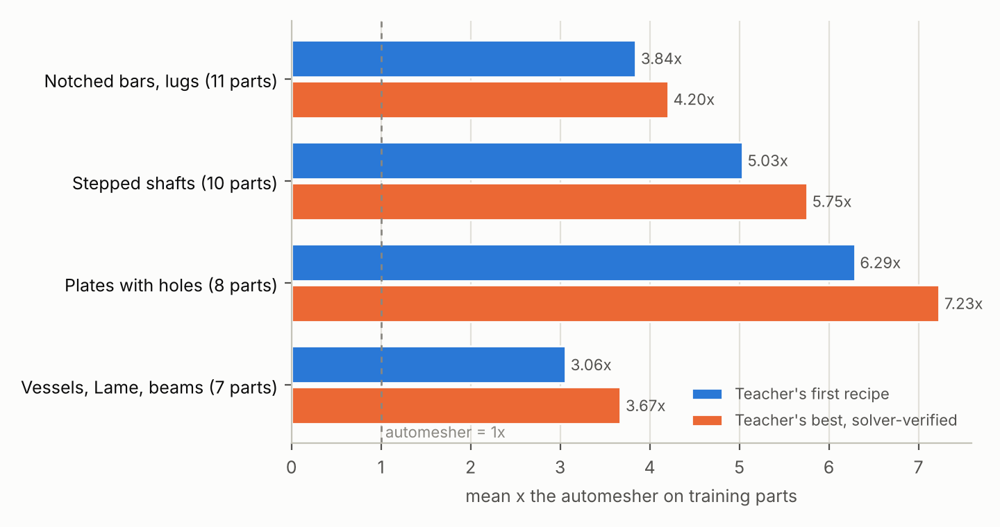

# wsp: teaching a small open model to mesh

A large teacher (Claude Opus 5.5) makes a small open model (default `Qwen/Qwen3.5-0.8B`) good at
setting up FEA meshes, so that one cheap forward pass, not an agent loop on a frontier model, writes
the mesh recipe. Everything is scored the way the swarm is scored: field mode, **x the automesher**
(the gmsh default quadratic mesh = 1x; `ace/checks.py`, `ace/field_error.py`).

Methods, on one shared harness:

| method | what changes | code |
|---|---|---|
| base | nothing: the open model as it is | `wsp/student.py` |
| playbook | the teacher's lessons in the prompt (ACE-style context, no weight change) | `wsp/data/playbook.md` |
| **weight-space programming (WSP)** | the teacher edits the weights directly, without gradients | `wsp/kernel.py`, `wsp/editor.py` |
| LoRA SFT (distillation) | LoRA on the teacher's solver-verified recipes | `wsp/sft.py` |
| RFT | one round of rejection sampling: the student's own samples, kept when the solver scores them well | `wsp/rft.py` |
| best-of-k + ZZ | k samples, the one with the smallest reference-free ZZ error x DOFs is kept | `wsp/evaluate.py --select-zz` |
| heuristic | a hand-written rule built from the teacher's lessons (no model) | `wsp/heuristic.py` |
| teacher zero-shot | Opus 5.5 itself, single shot from the same prompt, no feedback | `wsp_runs/opus_zeroshot/` |

## Weight-space programming, in one paragraph

"Sparks of Weight-Space Programming: LLMs can natively read & write neural network weights" (Rikiya Takehi,
Jayden Teoh, Alex Zhang, Omar Khattab, MIT CSAIL, 2026-11-02, a blog post / technical report, not
peer reviewed): a general-purpose frontier model (GPT-6 Astra) reads and writes a network's weights
directly, around a natural-language goal, with no optimizer and no gradients. It names the game a
17k-weight policy was trained on from the raw weights, writes MinAtar and Go networks from scratch, and,
in Experiment 8, edits Qwen3.5-0.8B in a Python kernel over the weights with 10-50 budgeted forward passes:
it traced the model's thinking loops to one direction written by the MLPs of layers 15 and 19 and
subtracted it from 64 output columns in each (131,072 weights, 0.016 %), which took MATH-500 from 7.9 %
to 48.1 % and IFEval from 21.0 % to 62.3 %. **The same post reports the limit that matters here:** on
Gemma 3 270M, which does not loop, edits moved MATH-500 by at most about a point; "editing weights could
remove an obstacle that hid an ability, but it could not add an ability the model lacked."

`wsp/kernel.py` reproduces that protocol for our task, after the independent replication
[openwsp/openwsp](https://github.com/openwsp/openwsp) (MIT): a persistent kernel with `load`, `save_edit`,
`NAMES`, `tok`; an AST guard that refuses backward passes, optimizers, autograd, model layers and process /
network modules; frozen embeddings, output layer and final norm; whole-tensor rescales refused; and a
forward tool with a pass budget. Its GENERATE pass is ours: the student answers practice parts and every
answer is meshed, solved and scored, so the editor sees x the automesher per answer. TEACHER_FORCED returns
log-probs, top-k, residual-stream states and MLP activations. The editor also gets the teacher's best
verified recipe for each practice part (the analogue of Exp 8's reference solutions).

## The task the student does

One prompt in, one JSON recipe out, the way the swarm agents call `mesh(h, order, refinements)`:

```json
{"order": 2, "h": 60, "refinements": [{"curve": 3, "size": 3, "radius": 50}, {"corner": 4, "size": 2.5, "radius": 80}]}
```

- The prompt (`python -m wsp.task prompt <pid>`) is the problem statement, the part's curves and notable
  corners (re-entrant, acute, ends of supports and loads), the automesher's error and DOFs, the score
  formula and the answer format.
- **Lengths are in u = part diagonal / 1000**, from the bounding-box corner, so every part looks the same
  size to the model: h is about 20-100 u, a notch root about 1-5 u. A sub-1B model learns that far more
  easily than raw sizes from 0.0005 m to 4 (Cook's membrane).
- Refinements name a corner or curve by its tag, so the model never copies coordinates.
- The harness meshes the recipe, solves it with the correct setup (the statement spells the setup out;
  meshing is the skill under test) and scores it. An invalid answer (no JSON, unknown tag, over the node
  cap, quality gate, folded cells) scores 0.

**Splits** (`wsp/problems.py`). Test = the repo's own 2D / axisymmetric elasticity benchmarks, which the
student never trains on: 22 in-family parts (notched bars, stepped shafts, plates with holes, clevis lugs,
pressure vessels, Kirsch, cantilever, Lamé) and 4 out-of-family parts whose families have no training
variant at all (Cook's membrane, NAFEMS LE1, NAFEMS LE11, the re-entrant L-bracket). Train = 36 new
parametric variants of the in-family families (other notch depths and radii, fillet ratios, hole sizes...),
registered only here. Left out: three smooth Lamé / rotating-disk problems where the automesher's own error
(0.08-0.15 %) is below the scoring floor (0.5 %), so no mesh can score near 1x.

## Results so far

Everything below is measured: every number is a recipe meshed, solved and scored against the fine
reference. **The student itself has not run yet**: this environment's network policy blocks
huggingface.co, so the open model's weights could not be downloaded (see "Run it").

**The teacher's verified recipes (the distillation data).** Four Claude Opus 5.5 teacher agents each took
a group of families, read exactly the student's prompt for each training part, and scored up to 8
recipes per part with the solver: 193 valid recipes over 36 parts, about 0.86M tokens in total.



| family group (training parts) | teacher's first recipe | teacher's best | scored recipes per part |
|---|---|---|---|
| notched bars, clevis lugs (11) | 3.84x | 4.20x | 5.2 |
| stepped shafts (10) | 5.03x | 5.75x | 5.5 |
| plates with holes, Kirsch (8) | 6.29x | 7.23x | 5.5 |
| pressure vessels, Lame, cantilevers (7) | 3.06x | 3.67x | 5.3 |
| **all 36** | **4.56x** | **5.20x** | 5.4 |

Solver feedback adds about 14 % over the teacher's first recipe (which already uses what it learned on
earlier parts of the same family). The four lessons files agree from different families: order 2; a
very coarse far field (h about 250-400 u, roughly one element across a section); the curve of a stress
raiser refined to about r/3 with a slope of 0.4-0.6; singular corners at the size floor with one gentle
ramp; and two counter-cases, bending depth (at least 4 quadratic elements across, a cliff) and parts whose
feature holds most of the energy (lugs: slope 0.12-0.2). Past a 2x gain the error x DOFs product
plateaus, so each part's ceiling is set by its geometry (notched bars: 7.1x for the shallowest notch,
3.4x for the deepest).

**A hand-written rule from those lessons, on the held-out benchmarks** (`wsp/heuristic.py`, constants
tuned on the training split only):

| | training parts (36) | held-out, in-family (22) | held-out, out-of-family (4) |
|---|---|---|---|
| heuristic | 3.86x | 3.86x (18 of 22 beat the automesher) | **0.81x** (1 of 4) |

The rule transfers to new sizes of the families it was written from, and fails on new kinds of parts.
It meshes NAFEMS LE1 and the Lame parts with h = 400 u and no refinement (36-50 DOFs, 0.03-0.08x), misses
the cantilever's bending-depth cliff (0.66x) and leaves Cook's clamped corners unrefined (0.93x).
Those are context-dependent calls that the teacher's recipes contain and a fixed rule cannot. They are
what the student has to learn.

ZEROSHOT_PLACEHOLDER

**What the student costs on this machine** (`python -m wsp.bench`: the real architectures with random
weights, since latency depends on shapes, not values; 4 Xeon cores, fp32, a 1000-token prompt and a
120-token recipe):

| | prefill | one recipe | per recipe, batch of 6 | LoRA step | SFT, 3 epochs over the demos |
|---|---|---|---|---|---|
| Qwen3.5-0.8B | 8.8 s | 29.6 s | 15.7 s | 14.1 s | about 2.3 h |
| Qwen3-0.6B | 2.9 s | 21.3 s | 10.0 s | 6.3 s | about 1 h |

On CPU, Qwen3.5's Gated DeltaNet layers run on the PyTorch reference path (the fast kernels are
GPU-only), which triples its prefill. Either way a recipe costs CPU seconds and no API tokens, against
several scored attempts (thousands of output tokens of a frontier model) for the teacher.

**Not run yet (needs the weights):** base, playbook, WSP, LoRA SFT, RFT and best-of-k on the held-out set.
`bash scripts/wsp_study.sh` runs all of them; the WSP session also needs an editor model.

## What to expect from each method, and what else is worth building

- **WSP alone will not teach meshing.** The paper's own negative result (Gemma 3 270M) is the relevant
  one: edits removed an obstacle that hid an ability (Qwen's loops), but could not add an ability the
  model lacked. A sub-1B model has no meshing skill to unhide: it does not know that re-entrant corners
  are singular or that a notch root needs elements a fraction of its radius. Expect WSP on the base
  model to fix systematic failures at most: malformed JSON, copying the example's tags, linear elements,
  absurd sizes. That is still worth measuring because it is cheap: 0.016 % of the weights, no training
  data beyond practice prompts.
- **Distillation is the method that adds the skill.** The teacher's solver-verified recipes
  (`wsp/data/demos.jsonl`) are the training data; the student learns to output in one shot what took the
  teacher several scored attempts.
- **The solver is an exact, cheap reward**, about 1-3 s per 2D answer, so RL is the natural next step after
  SFT. `wsp/rft.py` is one round of rejection sampling. GRPO (the student's own samples ranked by the
  score) is the stronger version and wants a GPU.
- **WSP on the distilled student** is where weight editing should pay off: repairing residual,
  systematic failures of an already-capable model without retraining.

Methods worth adding, most useful first:

1. **GRPO / multi-round expert iteration** with x the automesher as the reward. This is the biggest
   expected gain after SFT, and the reward needs no learned model.
2. **Constrained decoding**: a JSON grammar plus the part's valid tags. Invalid answers go to zero at no
   training cost.
3. **A second turn with reference-free feedback**: the student sees its first mesh's ZZ hotspots (what the
   swarm agents see after each solve) and revises. That is closer to the ACE agents, and the RFT data for
   it comes from the same scorer.
4. **More, and more varied, training parts**: the gold generator's ABC parts in 3D, and more 2D
   families. 36 parts from 9 families is small, and out-of-family transfer is what the test measures.
5. **Context baking**: turn the swarm's ACE playbooks into weights in closed form ("prompt baking",
   "transmuting prompts into weights"), so the cheap model carries the swarm's notebook without the
   context.
6. **Hypernetwork-generated adapters** (Text-to-LoRA / Drag-and-Drop LLMs): an adapter per part family
   from its description. Probably overkill at this data size.

## Run it

```bash
pip install -e ".[ace,wsp]"
python -m wsp.refs                                  # references + automesher baselines (~10 min, CPU)
python -m wsp.task prompt cooks_membrane            # what the student sees
python -m wsp.task score cooks_membrane '{"order": 2, "h": 60, "refinements": []}'
bash scripts/wsp_study.sh                           # every method, evaluation, figures
```

The weight-space programming session needs an editor model:

```bash
# automated, Claude Opus through the API
ANTHROPIC_API_KEY=... python -m wsp.editor run --session wsp_runs/wsp1 --passes 25
# or keep a session open and drive it from a Claude Code session (any editor that can write files)
python -m wsp.editor serve --session wsp_runs/wsp1 --passes 25 &
python -m wsp.editor message --session wsp_runs/wsp1             # the task message
python -m wsp.editor send --session wsp_runs/wsp1 block.md       # one ```python or ```forward block
```

Offline tests (`tests/test_wsp.py`) run the whole pipeline on `wsp/tiny.py`, a random 4-layer Qwen3.5
with a tokenizer trained on our prompts: chat template, generation, a WSP session (guard, edit, both
pass types), a LoRA step and adapter reload. They check plumbing, not quality.

## Choice of student

`Qwen/Qwen3.5-0.8B`: Apache-2.0 and ungated; 24 layers (18 Gated DeltaNet + 6 full attention); the model of
the paper's Experiment 8, so a WSP result here is comparable; and LoRA fine-tunes of it match models 2.5-4x
larger on structured JSON extraction (arXiv 2606.08051). It runs in fp32 on a 4-core CPU without bf16
instructions (3.2 GB). The Gated DeltaNet kernels are GPU-only, so on CPU transformers uses its PyTorch
reference path; if that is too slow, `Qwen/Qwen3-0.6B` (a plain transformer) is the fallback
(`WSP_MODEL=Qwen/Qwen3-0.6B`). Thinking is off: the answer is a ~100-token JSON object.
